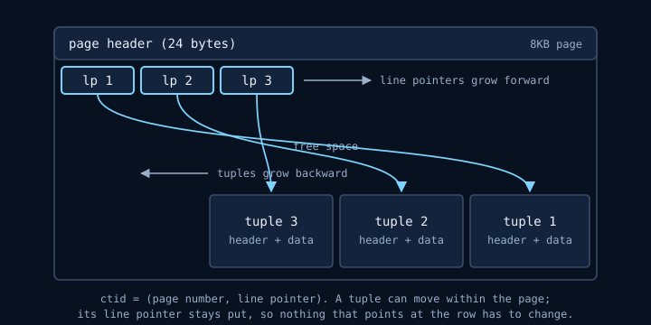
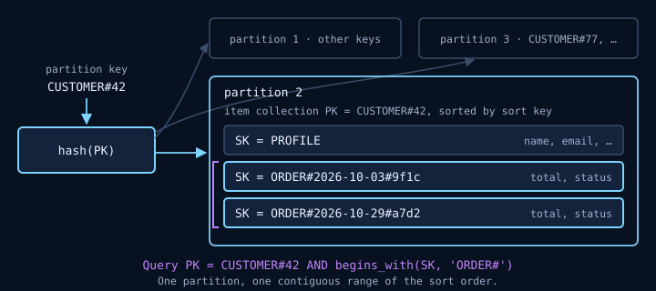

"Which database should we use?" is usually asked as a question about products. It's better asked as a question about the data: what shape it has, how it's read, how it's written, what has to be true about it after a crash, and how big it gets. Answer those and the product mostly picks itself. Skip them and you get a database chosen by familiarity, which works right up until the workload stops resembling whatever the team built last.

So this post starts with workloads rather than technologies:

> **A. Orders and payments.** Customers, orders, line items, payments, refunds. Money must balance. Finance wants reports nobody has thought of yet.
>
> **B. Product telemetry.** Every click and page view, appended forever. Billions of rows a month. Queries are "daily active users by country for the last 90 days."
>
> **C. Sessions and shopping carts.** Read and written by key on every request. Tens of thousands of requests a second at peak. Single-digit millisecond budget. Expires after a few days.
>
> **D. A globally distributed user profile and catalogue.** Users in Europe, the Americas and Asia, each expecting local latency. Writes happen everywhere. Some staleness is fine; losing a user's own update in front of them is not.
>
> **E. CMS content.** Articles with wildly varying structure — some have galleries, some have embedded quizzes, some have neither. Read far more than written.

Each of these gets resolved at the end. The middle is the material you need to resolve them, including — because it's where the real trade-offs come from — how a database actually stores data and finds it again.

Like the rest of the software posts, this one is AI-written, so its specific claims — limits, defaults, version-introduced behaviour, and how engines behave on disk — are footnoted against the vendors' own documentation. Where a statement is reasoning built on those sources rather than something they say, the wording says so. Treat an uncited number as an opinion.

## The questions to ask first

Before naming any technology, these are the questions that decide it:

- **Are the access patterns known in advance, or ad hoc?** If you can list every query the system will ever run, you can design storage around them. If finance will invent new questions next quarter, you need a query planner.
- **Point lookups or scans?** Fetching one row by key and summing a column across a billion rows are opposite workloads. One storage layout cannot be optimal for both.
- **What are the relationships?** Data that's naturally a tree (an order and its lines) can live in one document. Data that's a graph of shared entities (products referenced by many orders, customers by many addresses) wants joins.
- **What must be atomic?** One row, one entity, one customer's data, or arbitrary sets of rows? The scope of a transaction you need is one of the strongest constraints there is.
- **How consistent must reads be?** Read-your-own-writes? Globally linearizable? Is a second of staleness acceptable?
- **How big, how fast, and growing how?** Volume, throughput, and whether either grows without bound.
- **Where are the users?** One region or several, and do writes happen in more than one?
- **How long does data live?** Forever, until a TTL, or until an archival policy moves it?
- **What's the cost and operational model?** A server you run, a managed instance you size, or a serverless service billed per request — which changes what "an expensive query" means.

The rest of the post is these questions applied.

## SQL vs NoSQL, and the actual distinction

The popular framing is "schema versus schemaless." That's the least important difference. Every system that stores data has a schema; the question is only whether the database enforces it on write or your code assumes it on read. A document store with no declared schema still has one — it lives in every piece of code that reads a field and expects it to be there, and it's harder to change because nobody can see all of it.

The distinction that matters is **query flexibility versus predictable scale**.

A relational database stores data normalised — each fact once — and reassembles it at query time with joins. A planner decides how to execute each query from statistics about the data. That's what makes it good at questions nobody anticipated: you write the SQL, the planner works out how. Transactions span any rows you like, and constraints (unique, foreign key, check) are enforced by the database itself, which — as the [API post]() argues at length — is the only place they're reliably enforced.

What you pay for that flexibility is that the cost of a query is decided at runtime, by a planner, from statistics. Usually that's fine. Occasionally a query that took 5ms yesterday takes 5 seconds today because the statistics changed and the planner chose differently. And scaling writes beyond one primary is genuinely hard, because transactions and constraints that span arbitrary rows are hard to distribute.

"NoSQL" is not one thing. It's a family:

- **Key-value** — get and put by key. Redis, the simplest use of DynamoDB.
- **Document** — a key maps to a structured document (JSON) you can query into. MongoDB, Cosmos DB's NoSQL API.
- **Wide-column** — rows keyed by a partition key and sorted by a clustering key within it. Cassandra; DynamoDB's data model is close to this.
- **Graph** — nodes and edges, for traversal-heavy queries. Neo4j, Cosmos DB's Gremlin API.

What most of them share is the opposite trade: **you design storage around known access patterns, and in exchange every operation has a predictable cost at any scale.** Data is partitioned by a key you choose, operations that touch one partition are fast and cheap regardless of total size, and operations that don't are expensive or impossible. Transactions, where they exist, are usually scoped to one partition or capped in size.

Neither is better. They're priced differently. A relational database charges at query time for flexibility; a partitioned NoSQL store charges at design time for predictability. The question is which bill you'd rather pay.

### Postgres is the default for a reason

For most applications the right starting point is a relational database, and in practice that's usually Postgres. Not because it wins every benchmark, but because it covers more of the question list above than anything else: ad-hoc queries, real transactions, enforced constraints, and — with `jsonb` — a credible document store in the same database. A `jsonb` column with a GIN index handles "some fields vary per row" without a second system.[^jsonb]

The cases where it stops being the default are the cases where one of the questions above has an extreme answer: throughput or geography beyond what one primary can serve, or analytical scans over data far larger than memory. Those are exactly the cases the other technologies in this post exist for. But to understand *why* they exist — why a row store is bad at scans, why an LSM is good at writes, why a partition key matters so much — you need to look underneath.

## Underneath: how a database actually stores and finds data

Every storage engine is an answer to two physical facts. Storage is read and written in fixed-size units — Postgres, for instance, stores every table and index as files made of 8KB pages[^filelayout] — and **a page that isn't in memory is expensive to fetch, much more so when fetches are random rather than sequential.** Postgres's own planner encodes this: by default it costs a random page fetch at four times a sequential one, and its documentation notes that the real gap on durable storage is "normally much more expensive than four times," with the default kept low only because most random reads are assumed to hit cache.[^pagecost] Everything below — pages, indexes, logs, compaction — is about touching fewer pages, or touching them sequentially rather than randomly.

Postgres is a good engine to learn this on, because it's well documented and it makes some unusual choices that clarify the general picture by contrast.

### Pages and the heap

Postgres stores every table and every index as an array of fixed-size **pages**, usually 8KB, and the page is the unit it reads and writes — 16 disk sectors at a time, in the docs' own arithmetic.[^pagelayout][^walreliability] So to read one row, Postgres reads the whole page that contains it.

A table page has a small fixed header, then an array of **line pointers** growing forward from the start, then free space, then the actual row data (**tuples**) growing backward from the end:



The indirection matters. A row's address — its **`ctid`** — is (page number, line pointer number), and a line pointer is never moved while it's in use, so the tuple itself can be shifted around within the page without anything that points at it needing to change.[^pagelayout]

The table itself is a **heap**: tuples are stored in no particular order, wherever there's room. That's an important and somewhat unusual choice, and it comes back when we compare with MySQL.

Each tuple carries a header (23 bytes on most machines) before the data, and three fields in it are the key to how Postgres handles concurrency: `t_xmin`, the ID of the transaction that inserted this version; `t_xmax`, the ID of the transaction that deleted or replaced it; and `t_ctid`, which points to the newer version of the row if there is one.[^pagelayout]

Values too large to sit comfortably in a page are handled by **TOAST**. When a row would exceed about 2KB, Postgres compresses its large fields and, if that's not enough, moves them out of line into a separate TOAST table, leaving an 18-byte pointer behind. Any single value is capped at 1GB.[^toast] The practical consequence: wide `text` or `jsonb` columns cost little on queries that don't read them, and unchanged TOASTed values aren't rewritten when you update other columns.

### MVCC: why an UPDATE is really an INSERT

Postgres uses **multi-version concurrency control**. Instead of locking a row while someone reads it, it keeps multiple versions and lets each transaction see the versions that were committed as of its snapshot. The payoff, in the docs' words: "reading never blocks writing and writing never blocks reading."[^mvcc]

The mechanism is those header fields. An `UPDATE` doesn't modify the row in place. It sets `t_xmax` on the old version and writes a complete new version elsewhere, with `t_xmin` set to the updating transaction. A transaction's snapshot then decides which version it sees by comparing those IDs against what had committed when the snapshot was taken.


That has consequences that are worth being able to explain:

**Dead tuples and bloat.** Old versions don't disappear when the updating transaction commits — someone with an older snapshot might still need them. Once no transaction can see them, they're dead, and **`VACUUM`** reclaims their space for reuse. It doesn't normally give the space back to the operating system; it marks it reusable within the table.[^vacuum] A table with heavy updates and vacuum that can't keep up grows — that's bloat — and so do its indexes.

**Every index sees every version.** If a new row version lives at a new `ctid`, every index on the table needs a new entry pointing to it. An update that changes one unindexed column on a table with eight indexes can mean nine writes.

**HOT updates** are the mitigation. If the update doesn't change any indexed column, and there's free space on the same page for the new version, Postgres does a **heap-only tuple** update: the new version goes on the same page, chained from the old one, and no index entries are added. Old versions in the chain can then be pruned during normal operation, without waiting for vacuum.[^hot] This is why `fillfactor` exists — setting it below 100 leaves free space on each page so that updates can stay HOT. It's also a concrete reason not to index columns you don't query by: each one is a column whose update disqualifies HOT. The exception is BRIN, a "summarizing" index type covered below: since PostgreSQL 16, updating a column that only BRIN indexes cover no longer blocks a HOT update.[^hot][^pg16]

**Transaction ID wraparound.** Transaction IDs are 32-bit, compared with modular arithmetic, so the system has to vacuum every table at least once every two billion transactions. Vacuum **freezes** old tuples, marking them as visible to everyone so their XID no longer matters. If that doesn't happen, Postgres warns as it gets close and eventually refuses to assign new transaction IDs at all — a full write outage — to avoid old rows suddenly appearing to be in the future.[^vacuum] This is the canonical reason "never disable autovacuum" is a rule rather than a suggestion.

The **visibility map** ties this together. It keeps two bits per heap page: *all-visible*, meaning every tuple on the page is visible to all transactions, and *all-frozen*, meaning every tuple is already frozen. Ordinary vacuum skips all-visible pages; the aggressive vacuum that protects against wraparound can skip all-frozen ones, which is what keeps it affordable on a large, mostly static table. Index-only scans use the all-visible bit to skip heap lookups — which comes back below.[^vacuum]

### The WAL: how durability works

A committed transaction must survive a crash. The naive way is to write every changed data page to disk at commit, which would be slow: those pages are scattered all over the files, so every commit would be many random writes.

Postgres instead uses a **write-ahead log**. The rule is that a change to a data file may be written only *after* a log record describing it has been flushed to durable storage.[^wal] At commit, only the WAL needs flushing — and the WAL is appended sequentially, so that's one sequential write rather than many random ones. With many small transactions running concurrently, one `fsync` of the WAL can commit several of them at once.[^wal] The changed data pages stay in memory and are written back lazily.

After a crash, Postgres replays the WAL from the last **checkpoint**, redoing any changes that hadn't reached the data files.[^wal] Checkpoints periodically flush dirty pages so that replay has a bounded starting point.

The log is only as durable as the hardware lets it be. Postgres forces the WAL to storage with `fsync` or an equivalent, but a drive or controller with a volatile write-back cache can acknowledge a write that a power cut then loses — the docs specifically warn that many SSDs have such caches and don't honour flush commands by default.[^walreliability] And because an 8KB page spans sixteen 512-byte sectors, a crash mid-write can leave a **torn page**, half old and half new, which row-level WAL records can't repair. So the first time a page is modified after a checkpoint, Postgres writes the *entire* page image into the WAL (`full_page_writes`, on by default), giving recovery a known-good copy to start from.[^walreliability][^fullpage] That's also why WAL volume jumps just after each checkpoint, and why spacing checkpoints further apart reduces it.[^fullpage]

The WAL is also the replication mechanism. A streaming replica is, more or less, another server continuously replaying the primary's WAL. And **logical decoding** streams the same changes out to external consumers as row-level events — the basis for change data capture, and the cleanest way to feed a second database from Postgres without dual writes.[^logical]

The general lesson, which the WAL documentation states in Postgres's own terms: **a database turns many scattered page writes into one sequential log write at commit, and writes the real structure later.**[^wal] LSM trees, below, take that idea to its conclusion.

### "Storage engines": Postgres's heap vs InnoDB's clustered index

"Which storage engine does Postgres use" is a reasonable interview question with a slightly surprising answer. For most of its history the heap was simply *how Postgres stored tables*. Since PostgreSQL 12 there's a **table access method** interface, which lets an extension supply a different storage implementation behind the same SQL; the built-in `heap` is the default and the reference implementation.[^tableam] Alternatives exist as extensions — columnar storage among them — but in practice almost every Postgres table is a heap.

MySQL went the other way: it has a pluggable storage engine architecture, where engines handle the storage for different table types and can be chosen per table.[^mysqlengines] The default, **InnoDB**, makes a different fundamental choice. An InnoDB table *is* its primary key index: the rows are stored in the leaf pages of a B-tree ordered by primary key. That's a **clustered index**. Every secondary index stores the primary key value rather than a physical row address, and a lookup through a secondary index finds the primary key and then searches the clustered index for the row.[^innodb]

The two designs have opposite strengths:

- **Range scans by primary key** are cheap in InnoDB — the rows are physically in key order. In Postgres the heap keeps no order, so a range of IDs can be scattered across many pages. Postgres's `CLUSTER` command exists precisely to fix this: it physically rewrites a table in index order so that a range scan finds neighbouring rows on the same page — but it's a one-time reorder, and later inserts and updates aren't kept in order.[^cluster] (SQL Server makes the same choice as InnoDB when a table has a clustered index, and stores rows in an unordered heap when it doesn't.[^sqlserver])
- **Secondary index lookups** are one step in Postgres (index → `ctid` → heap page) and two in InnoDB (secondary → primary key → clustered index).[^innodb]
- **Primary key size** matters much more in InnoDB, because every secondary index carries a copy. The MySQL docs say directly that a short primary key is advantageous.[^innodb]
- **Random primary keys** hurt InnoDB more. Inserting UUIDv4 keys into a clustered index means inserting *rows* at random positions throughout the table's B-tree. MySQL's documentation puts numbers on the result: sequential inserts leave clustered index pages about 15/16 full, random inserts anywhere from 1/2 to 15/16 full.[^innodbphysical] In Postgres the row goes wherever there's room in the heap, and only the index takes the random insert.

That last point is a good reason to understand the B-tree itself.

### How a B-tree index works

A B-tree index is a balanced tree of pages. In Postgres, the bottom level is **leaf pages**, whose entries are key values with `ctid`s pointing to table rows; every level above is **internal pages**, whose entries are keys with pointers to the next level down. Each level is also a doubly linked list of its pages, and typically more than 99% of an index's pages are leaves.[^btree]


A lookup for key 145 reads the root, follows the pointer for the range 100–200, reads that internal page, follows the pointer for 130–160, and lands on the leaf holding 145. **One page visit per level.** A range scan for 145–175 does the same descent and then walks right along the linked leaves, which is why B-trees serve `BETWEEN`, `<`, `>` and `ORDER BY` — anything that maps to a contiguous key range.[^indextypes] Prefix `LIKE 'foo%'` belongs on that list too, with a caveat that catches people: a plain B-tree only serves it under the "C" collation. On a database using a normal locale, the index needs the `text_pattern_ops` (or `varchar_pattern_ops`) operator class, which compares character by character instead of by locale rules.[^indextypes][^opclass]

The reason B-trees work so well is **fan-out**. This part is arithmetic rather than anything a manual states, so here it is in full. With an 8-byte key, an 8KB page holds a few hundred entries once you allow for per-entry overhead; call it 300. A root plus two internal levels can address 300 × 300 × 300 ≈ 27 million leaf pages, and at ~300 entries per leaf that's around 8 billion rows — **four page visits for any one of 8 billion rows.** Add one more level and the reach is multiplied by 300 again.

The upper levels of the tree are tiny by comparison — the docs note that typically over 99% of an index's pages are leaves[^btree] — so they're usually already in memory, and most lookups reach storage only for the leaf, if at all. That's a claim you can check on your own system rather than take on trust: `EXPLAIN (ANALYZE, BUFFERS)` reports, per plan node, how many pages were found in Postgres's buffer cache (`shared hit`) and how many had to be requested from the operating system (`shared read`).[^explain]

The tree grows from the bottom. When an insert doesn't fit in a leaf, the page **splits**: part of its entries move to a new page, and a pointer to the new page is inserted into the parent, which may split in turn. If the split cascades all the way up and the root overflows, a new root is created above it, adding a level.[^btree] That's why the tree stays balanced: every leaf is always the same distance from the root.

**Why key order matters.** If keys arrive in increasing order — an identity column, a timestamp, a UUIDv7 — every insert goes to the rightmost leaf. Pages fill up and split at the edge, and the part of the index being written is one small region. If keys arrive randomly — UUIDv4 — inserts land on leaves all over the index, pages split everywhere, and they're left partly empty: MySQL documents the result for its clustered indexes as pages anywhere from half to 15/16 full under random inserts, against about 15/16 full for sequential ones.[^innodbphysical] The mechanism is the B-tree's, not MySQL's, so the same pressure applies to a Postgres index on a random key. The consequence that follows from the cost model above: every insert touches a different leaf page, so once the index is larger than the cache, those page visits stop being cache hits and become random fetches. PostgreSQL 18 added a built-in `uuidv7()` that generates time-ordered UUIDs, which keeps the global uniqueness of a UUID without the random insert pattern.[^uuid][^pg18]

Two refinements in modern Postgres are worth knowing. **Deduplication** stores repeated key values once with a sorted list of `ctid`s, rather than once per row, which shrinks indexes on low-cardinality columns considerably; it's on by default.[^btree] And **bottom-up index deletion** (PostgreSQL 14) removes index entries for dead row versions proactively when a page is about to split because of update churn, instead of waiting for vacuum.[^btree]

### Using indexes well

Knowing the structure explains the rules that otherwise look arbitrary.

**Composite indexes have a leftmost-prefix rule.** An index on `(customer_id, created_at)` is sorted by `customer_id`, then by `created_at` within each customer. It can serve `WHERE customer_id = 42 AND created_at > '2026-01-01'` with one descent and a short walk. It's far less useful for `WHERE created_at > '2026-01-01'` alone, because matching rows are spread across every customer's section of the tree. The Postgres docs give the exact rule: equality constraints on the leading columns, plus an inequality on the first column without an equality, are what limit the portion of the index scanned.[^multicolumn] Hence the heuristic: **equality columns first, then the range column.** (PostgreSQL 18 added skip scan, which can use an index whose leading column isn't constrained when that column has few distinct values. It's a useful fallback, not a reason to get the column order wrong.[^multicolumn][^pg18])

**Covering indexes avoid the heap entirely.** A normal index scan finds `ctid`s in the index and then fetches each row from the heap — rows fetched in index order rather than physical order, which the docs describe as the expensive way to read them.[^explain] If every column the query needs is in the index, Postgres can do an **index-only scan** and skip the heap. `INCLUDE` adds non-key payload columns to a B-tree index for exactly this purpose.[^indexonly]

There's a catch that follows directly from MVCC: index entries don't carry visibility information, so Postgres can only skip the heap for pages that the visibility map marks all-visible. On a table that's being updated heavily, many pages won't be, and the "index-only" scan goes to the heap anyway.[^indexonly] Index-only scans pay off on data that changes slowly, and a table that vacuum hasn't processed recently will show more heap fetches than you expect.

**Partial and expression indexes** index a subset of rows (`WHERE status = 'pending'`) or a computed value (`lower(email)`).[^partial][^expression] A partial index over the 1% of orders still pending is a fraction of the size of a full one, which makes it far more likely to stay cached — and the docs' own reasoning for partial indexes is that a query for a common value won't use the index anyway, so indexing those rows only adds size.[^partial]

**Every index is paid for on every write.** An index speeds up the reads that use it and slows down every insert, every non-HOT update, and every delete, and it competes for memory. "Add an index" is a trade, not a free fix.

Here's what that looks like in a plan, on an `orders` table with an index only on `id`:

```sql
EXPLAIN SELECT id, total FROM orders
WHERE customer_id = 42 AND created_at >= '2026-10-01'
ORDER BY created_at;

-- Sort
--   Sort Key: created_at
--   ->  Seq Scan on orders
--         Filter: ((customer_id = 42) AND (created_at >= '2026-10-01'))
```

A sequential scan reads every page of the table and discards almost everything. Add a composite, covering index:

```sql
CREATE INDEX orders_customer_created
    ON orders (customer_id, created_at) INCLUDE (id, total);

-- Index Only Scan using orders_customer_created on orders
--   Index Cond: ((customer_id = 42) AND (created_at >= '2026-10-01'))
```

The equality column comes first, so the scan starts at customer 42. The range column comes second, so it starts at the right date and walks forward. The index is already in `created_at` order within the customer, so the sort disappears. `id` and `total` — the only other columns the query returns — are included, so the heap isn't touched, on pages the visibility map says are all-visible. Leave either out and the plan falls back to a plain index scan with a heap fetch per row. (These are plan shapes, abbreviated; on a real table, run `EXPLAIN (ANALYZE, BUFFERS)` and read the buffer counts, which tell you how many pages were actually touched.)

**Why the planner sometimes ignores your index — correctly.** For a query that matches a large fraction of the table, following an index means fetching rows one at a time out of physical order, and reading the whole table sequentially is cheaper; the docs note that a sequential scan and sort "frequently beats an index scan for sorting many rows, because of the nonsequential disk access required by the index scan."[^explain] The planner estimates selectivity — the fraction of rows a condition matches — from statistics, and prices each plan with the page costs described at the top of this section.[^plannerstats][^pagecost] In between, it may use a **bitmap heap scan**: collect all matching row locations from the index, sort them into physical order, and then read each needed page once.[^explain] If the planner is choosing badly, out-of-date statistics are a more likely cause than a missing index; `ANALYZE` refreshes them.[^plannerstats]

### The other index types

B-tree is the default and the right answer most of the time. Postgres has others for data that doesn't fit a single sort order:[^indextypes]

- **Hash** — equality only. Rarely better than a B-tree in practice.
- **GIN** — an inverted index with one entry per *component* of a value. The right choice for "which rows contain this": `jsonb` containment (`@>`), arrays, full-text search.
- **GiST / SP-GiST** — frameworks for non-linear data: geometry, ranges, nearest-neighbour searches (`ORDER BY location <-> point`). PostGIS lives here.
- **BRIN** — stores only a summary (for ordered types, the min and max) of each range of physically adjacent pages. It's designed for very large tables where a column correlates with physical location — the docs' own example is an order date, where earlier orders sit earlier in the table — which is exactly the shape of an append-only time-series table.[^indextypes][^brin] Because it holds one entry per block range rather than per row, it's very small, and the index's size is directly set by how many pages each range covers.[^brin] The trade is that it's lossy: it can only rule out block ranges, so every row in a matching range is rechecked.[^brin]

### B-trees vs LSM trees

A B-tree updates data **in place**: an insert finds the right leaf page and modifies it. Reads are excellent — one descent, data is where the index says. Writes are random I/O plus the WAL.

A **log-structured merge tree** goes the other way. The design was introduced by O'Neil and colleagues in 1996 as a way to make high insert rates affordable by deferring and batching index changes,[^lsmpaper] and it underlies many write-heavy stores; RocksDB is a widely embedded, well-documented implementation. The write path in RocksDB:[^rocksdb]

1. A write goes to an in-memory sorted structure, the **memtable**, and to a log for crash recovery.
2. When the memtable fills, it's flushed to disk as an immutable, sorted **SST file**. This is a sequential write.
3. Over time there are many SST files, possibly holding different versions of the same key. Background **compaction** merges them, keeping the newest version and dropping overwritten and deleted keys.


Data files are written whole and never modified in place — new data arrives by flushing a memtable, old data leaves by compaction rewriting files — so the write path is sequential, which by the cost model at the top of this section is the cheap kind of I/O.[^rocksdb][^pagecost] The price moves to reads: a key could be in the memtable or any of several SST files, so a read may check several places. **Bloom filters** — small probabilistic structures that can say "this key is definitely not in this file" — let reads skip files that can't contain the key.[^rocksdb] Compaction strategies trade between *write amplification* (how often data is rewritten), *read amplification* (how many places a read checks) and *space amplification* (how much obsolete data sits on disk). In RocksDB's terms, universal compaction typically gives lower write amplification at the cost of higher space and read amplification than the default leveled compaction.[^rocksdb]

The summary is a trade you'll see again: **B-trees optimise for reads and pay on writes; LSM trees optimise for writes and pay on reads and in background compaction.** The columnar engine in the next section is a third answer, optimised for scanning.

## Row vs column storage: OLTP vs OLAP

Everything above is a **row store**: a page holds complete rows. That's ideal for transactional work (OLTP) — fetch an order, update a payment — where you want all the columns of a few rows.

It's the wrong layout for analytics (OLAP). "Sum revenue by country for the last 90 days" needs two or three columns from a billion rows. A row store reads every page of every row, including the twenty columns the query doesn't care about. Indexes don't save you: the query really does need most of the rows.

A **column store** turns the layout sideways. The values of each column are stored together, so only the columns a query references are read from disk.[^chintro] And because a column holds values of one type that are often similar or repeated — country codes, event types, timestamps close to each other — column stores are, in ClickHouse's words, "particularly well suited" to compression, which shrinks storage and, since disk and network throughput are often the bottleneck, frequently speeds queries up too.[^chfast] Execution engines then pass data between operators in batches of values rather than one row at a time (vectorised execution), which lets them use SIMD instructions to process many values at once.[^chfast]


The cost is the mirror image, and it follows from the layout rather than from any one product's docs: fetching one complete row means visiting every column's data, and changing one row in place is awkward because that data is compressed and sorted in large blocks. ClickHouse's own guidance — batched inserts, and updates described as heavy operations — is the practical form of that trade, covered next. Column stores are built for appending in bulk and reading in bulk.

### ClickHouse and MergeTree

ClickHouse is a widely used open-source column store, and its main table engine family, **MergeTree**, combines the column layout with an LSM-like write path.

```sql
CREATE TABLE events
(
    event_time  DateTime,
    event_type  LowCardinality(String),
    country     LowCardinality(String),
    user_id     UInt64,
    properties  String
)
ENGINE = MergeTree
PARTITION BY toYYYYMM(event_time)
ORDER BY (country, event_time);
```

Each insert writes a new immutable **data part** to disk, sorted by the `ORDER BY` key, and ClickHouse merges parts in the background — the same shape as SST files and compaction.[^mergetree][^chfast] That's why ClickHouse wants inserts in large batches — its guidance is at least 1,000 rows per insert, ideally 10,000–100,000 — because every insert creates a part, and many small inserts create more parts than background merges can keep up with.[^chinsert]

The `ORDER BY` key doubles as the primary key, and it works very differently from a B-tree. It's a **sparse index**: rather than one entry per row, it stores the key value of the first row of every **granule** — 8,192 rows by default. A query uses these marks to skip granules that can't contain matching rows, and the index is small enough to sit in memory.[^mergetree] So the sort order is the most important design decision for the table, and it has to follow the queries the table will actually serve. Scenario B's query is "daily active users by country for the last 90 days." With `(country, event_time)`, each country's rows are contiguous and time-ordered within it, so a filter on country and a date range skips straight to the matching granules. Leading with a column the query doesn't constrain — say `event_type` — would split every country's 90 days across every event type's section of the table and defeat the skipping. As a rule: columns the common queries filter on, in the order they're filtered, generally lower-cardinality before higher.

Two consequences that trip people up:

**The primary key is not unique.** ClickHouse will happily store several rows with the same key.[^mergetree] If you need "latest version of each row," `ReplacingMergeTree` removes duplicates — but only when parts merge, which happens in the background at an unpredictable time. The docs are explicit that it doesn't guarantee the absence of duplicates; queries that need exact answers add `FINAL`, which deduplicates at query time and costs accordingly.[^replacing]

**Updates and deletes are heavy.** `ALTER TABLE ... UPDATE` is a *mutation*, asynchronous by default, and the docs describe it as "a heavy operation not designed for frequent use."[^alterupdate] Lightweight deletes mark rows deleted immediately and clean up in the background, which helps, but the design point is unchanged: **a column store is for data you append and analyse, not data you edit.**

The same model, with a different operational shape, is behind BigQuery, Snowflake and Redshift (managed warehouses, billed by scan or compute) and DuckDB (an embedded column store, excellent for analysis on one machine). The choice between them is mostly about who runs it and how you pay. The storage trade-off is the same.

## DynamoDB: design the access patterns first

DynamoDB is AWS's managed key-value and wide-column store, and it's the purest example of the predictable-scale trade. You get consistent single-digit millisecond operations at essentially any size — tables have no practical size limit[^dynamoquotas] — on the condition that every access pattern is designed into the keys up front.

**The data model.** Every item has a **partition key**, and optionally a **sort key**. The partition key is hashed to pick a partition. Within a partition, items with the same partition key are stored sorted by sort key — an **item collection**. Efficient operations are a `GetItem` by full key, or a `Query` for one partition key with a condition on the sort key (equals, range, begins-with). Anything else is a `Scan`, which reads the whole table and is almost always the wrong answer in production.

```text
PK                 SK                         attributes
CUSTOMER#42        PROFILE                    name, email, ...
CUSTOMER#42        ORDER#2026-10-03#9f1c      total, status, ...
CUSTOMER#42        ORDER#2026-10-29#a7d2      total, status, ...
CUSTOMER#77        PROFILE                    ...
```

This is the one place in DynamoDB where the item layout is something you design: items sharing a partition key are stored together and sorted by sort key, so a `Query` within one partition key reads a contiguous range. What DynamoDB does on disk beneath that, AWS doesn't document in the detail Postgres does, so this post doesn't guess.



"A customer and their orders, newest first" is now a single `Query` on `PK = CUSTOMER#42 AND begins_with(SK, 'ORDER#')`, in reverse sort order. This is **single-table design**: several entity types share one table, with key prefixes chosen so that each access pattern is one query. It's efficient, and its costs are real. The table is incomprehensible without the access-pattern document that produced it, and adding a pattern the keys didn't anticipate can mean a data migration.

**Secondary indexes** add access patterns. A **global secondary index** has its own partition and sort key and is maintained asynchronously, so reads from it are always eventually consistent.[^dynamoconsistency] A **local secondary index** shares the table's partition key with a different sort key; it must be created with the table, and it caps each item collection at 10GB.[^dynamolimits] Defaults are 20 GSIs and 5 LSIs per table.[^dynamoquotas]

**Limits that shape design:**

- An item is at most **400KB**, attribute names included.[^dynamolimits] Large blobs belong in S3, with a pointer in the item.
- `Query` and `Scan` return at most **1MB per call**, paginated with `LastEvaluatedKey`.[^dynamolimits]
- A transaction can include at most **100 items and 4MB**, within one account and region. On global tables, other regions can observe a partially applied transaction while it replicates.[^dynamolimits]
- Each partition is designed to deliver up to **3,000 read units and 1,000 write units per second**.[^dynamopartition]

**Hot partitions** follow from that last point. Throughput is spread across partitions, and a key that attracts disproportionate traffic — one celebrity user, one popular product, or a date as the partition key so that today's traffic all lands in one place — can throttle while the rest of the table idles. **Adaptive capacity** shifts throughput to hot partitions automatically and can even isolate a single heavily used item onto its own partition, but it can't take one key past the per-partition maximum.[^dynamoadaptive] If one key genuinely needs more, the answer is write sharding: suffix the key with a number from a known range — random, or computed from something you'll query by — so writes spread across partitions, at the cost of querying every suffix and merging the results to read it all back.[^dynamosharding]

**Consistency.** Within a region, reads are eventually consistent by default. Strongly consistent reads are available on tables and LSIs (not GSIs) and cost twice as much.[^dynamoconsistency] Transactional reads and writes cost double the units of their non-transactional versions.[^dynamolimits] Across regions, **global tables** replicate a table to several regions, writable in all of them, in one of two modes: multi-Region eventual consistency (the default, typically replicating within a second) or multi-Region strong consistency, where a write is synchronously replicated to another region before it returns and strongly consistent reads in any replica see the latest version.[^dynamoconsistency]

**Capacity modes.** On-demand is pay-per-request with no capacity planning, and AWS now recommends it as the default for most workloads. Provisioned bills for the capacity you set, used or not, and fits steady, forecastable load.[^dynamocapacity]

**TTL and Streams.** Set a numeric expiry attribute and DynamoDB deletes expired items — without consuming write throughput, but only "within a few days" of expiry, so reads must filter out items that have expired but not yet been deleted.[^dynamottl] **Streams** record a time-ordered sequence of item-level changes, retained for 24 hours, which is how you feed other systems — search indexes, analytics, aggregates — without dual writes.[^dynamostreams]

The way DynamoDB fails is specific and worth naming. The system runs beautifully for its designed access patterns, and then someone needs a query the keys don't support — "all orders over £500 last month across all customers." The options are a full scan, a new GSI (and its write cost), or exporting to a system that can answer ad-hoc questions. **DynamoDB is excellent when the questions are fixed. It's the wrong home for questions that aren't.**

## Azure Cosmos DB: partitioning, RUs, and five consistency levels

Cosmos DB is Azure's globally distributed multi-model database. Its core is a partitioned document store, and it overlaps with DynamoDB heavily: data is partitioned by a key you choose, single-partition operations are fast and predictable, and cross-partition work is expensive. The differences are in the cost model, the indexing defaults, and especially consistency.

**Request Units.** Every operation is charged in RUs, a normalised currency covering CPU, I/O and memory. A point read of a roughly 1KB item by ID and partition key costs about 1 RU; writes, queries and larger items cost more, and the same operation on the same data always costs the same.[^ru] You either provision RU/s (in increments of 100, or with autoscale) or use serverless and pay per RU consumed.[^ru] Provisioned RUs are provisioned in *every* region the account is replicated to.[^ru] Because a query's RU charge is returned in a response header, it's practical to measure the cost of each access pattern directly while designing.

**Partitioning.** Items with the same partition key value form a **logical partition**, which can hold up to 20GB. Logical partitions are mapped onto **physical partitions** that Cosmos manages, each serving up to 10,000 RU/s and 50GB.[^partitioning] So a single partition key value is limited to 10,000 RU/s — the same hot-key problem as DynamoDB. The partition key can't be changed in place after the container is created, and a partition key value on an item is immutable.[^partitioning] **Hierarchical partition keys**, up to three levels, address the 20GB limit for keys that genuinely grow large.[^partitioning]

The logical partition is also the **transaction boundary**: multi-item transactions (transactional batches, stored procedures) work only within one logical partition.[^partitioning] A query that doesn't specify the partition key fans out to every physical partition, at an extra 2–3 RU per partition on top of the work itself.[^partitioning]

**Indexing.** This is a real difference from DynamoDB. By default Cosmos indexes **every property of every item**, so ad-hoc filters on any field work without designing for them.[^indexpolicy] The cost is paid on writes: each indexed property adds RUs to every insert and update, and with everything indexed the index can be larger than the data. For write-heavy containers, excluding paths you never query is one of the most effective cost optimisations.[^indexpolicy]

**Composite indexes** follow two different rules, depending on what they're for.[^indexpolicy] A query that `ORDER BY`s two or more properties *requires* one, and its paths must match the `ORDER BY` exactly — same properties, same sequence, and the same direction on every path (or the opposite direction on every path). A composite index built to speed up *filters* follows the B-tree's leftmost-prefix logic instead: equality properties first, then at most one range property, last. A query that does both needs an index satisfying both, which usually means adding the filtered properties to the front of the `ORDER BY`.

**Consistency.** Most distributed databases offer strong or eventual. Cosmos offers five levels, strongest to weakest:[^consistency]

- **Strong** — linearizable: reads always return the latest committed write. Writes must commit in every region, so cross-region write latency is roughly twice the round trip between the farthest regions. Not available with multiple write regions.
- **Bounded staleness** — reads lag by at most *K* versions or *T* time.
- **Session** — read-your-writes and write-follows-reads within a client session, via a session token. The most widely used level.
- **Consistent prefix** — you may see old data, but never writes out of order; a transactional batch is seen whole or not at all.
- **Eventual** — no ordering guarantee.

The cost differs too. Strong and bounded staleness read from two replicas instead of one, so reads cost roughly twice the RUs.[^consistency] **Session is usually the right answer for user-facing applications**: users see their own changes immediately, other users see them shortly after, and you pay single-replica prices.

**Multi-region writes.** Cosmos can accept writes in every region, as DynamoDB's eventually consistent global tables also do. Concurrent writes to the same item in different regions then conflict, and by default **last writer wins** on the system timestamp, with a deleted version always beating an insert or replace. A custom merge stored procedure is possible on the NoSQL API.[^conflicts] "Last writer wins" means some concurrent writes are silently discarded, so multi-region writes suit data where that's acceptable, or where each item is effectively written from one region at a time.

**Change feed.** Every container has a change feed: inserts and updates in modification order, ordered within each partition key but not across them. The default "latest version" mode doesn't capture deletes; "all versions and deletes" mode does, but requires continuous backup.[^changefeed] It plays the role of DynamoDB Streams or Postgres logical decoding.

**The multiple APIs.** Cosmos exposes wire-compatible APIs for MongoDB, Cassandra, Gremlin and Table alongside its native NoSQL API.[^ru] This makes it easier to move an existing application, and the underlying partitioning, RU and consistency model still apply whichever API you use. The Mongo API on Cosmos is Cosmos with a Mongo-shaped interface, not MongoDB.

**Cosmos vs DynamoDB**, briefly. They're more alike than different. Cosmos indexes everything by default and gives you a SQL-like query language over documents, so it tolerates ad-hoc queries better. Its consistency model is more granular — five levels, chosen per account and overridable per request — where DynamoDB offers eventual or strong reads within a region and an eventual or strong mode for global tables. DynamoDB pushes harder toward designing every access pattern into keys, and its cost model is simpler to reason about. In practice the choice is mostly made by which cloud you're on.

## Trade-offs side by side

| | Postgres | SQL Server / MySQL InnoDB | MongoDB | ClickHouse | DynamoDB | Cosmos DB |
|---|---|---|---|---|---|---|
| **Storage structure** | Row pages in an unordered heap; B-tree indexes | Row pages in a clustered B-tree (or a heap, in SQL Server, without one) | Documents in the WiredTiger engine | Immutable columnar parts, merged in background | Partitioned item collections, sorted by sort key | Partitioned documents |
| **Indexing** | You choose; many index types | You choose | You choose | Sparse primary index on the sort key | Primary key plus GSIs/LSIs you design | Every property by default; tune by exclusion |
| **Query flexibility** | Highest; joins and a planner | Highest; joins and a planner | High within a document | High for aggregates; poor for point lookups | Designed access patterns only | SQL-like over documents; cross-partition costs RUs |
| **Transactions** | Arbitrary, ACID | Arbitrary, ACID | Single-document atomic; multi-document at extra cost | None in the OLTP sense | Up to 100 items / 4MB | Within one logical partition |
| **Consistency** | Strong on the primary | Strong on the primary | Tunable | Duplicates resolved only at merge, or with `FINAL` | Eventual or strong; global tables eventual or strong | Five levels |
| **Cost model** | Instance size | Instance size | Instance or managed tier | Instance or compute | Per request or provisioned | RU/s or serverless |
| **Characteristic failure** *(opinion)* | Bad plan or bloat under load; write ceiling | Random-key page splits; wide primary keys | Unbounded documents; schema drift | Treating it as OLTP | A query the keys don't support | Hot or oversized partition; RU bill |

Every row except the last summarises a sourced section above, plus MongoDB's storage-engine and transaction documentation for its column.[^wiredtiger][^mongotx] The last row is my judgement of how each one most often goes wrong.

## Polyglot persistence, and when not to

The scenarios below don't all land on one database, and a real system often uses more than one. The standard pairing is a transactional store as the source of truth and an analytical store fed from it: Postgres to ClickHouse via logical decoding, DynamoDB to an analytics store via Streams, Cosmos via the change feed.[^logical][^dynamostreams][^changefeed] The rule from the [API post]() applies directly: never write to two stores from application code and hope both succeed. Write to one, and propagate from its log — CDC or an outbox — so that a crash between the two writes can't silently lose data.

But every extra store is another system to run, monitor, secure, back up, and understand, and another consistency boundary between your own data. The usual mistake isn't too few databases. It's adding a second one before the first has actually run out. Postgres with `jsonb`, partial indexes and a read replica covers far more ground than it gets credit for.

**Use one database until a specific workload forces a second, and be able to name the workload.**

## Where this leaves the scenarios

**A. Orders and payments → Postgres.** The deciding questions are *what must be atomic* (an order, its lines and its payment, together) and *are queries known in advance* (no — finance will invent new ones). That's the relational sweet spot: transactions across rows, constraints enforced by the database (including the unique constraint that makes idempotency work), and a planner for ad-hoc reporting. Design notes: identity or UUIDv7 keys, so inserts stay at the right edge of the index; composite indexes such as `(customer_id, created_at)` for the known hot paths; and keep heavy analytics off the primary — a read replica first, an analytical store once that isn't enough. What's given up: horizontal write scaling, which this workload almost never needs.

**B. Product telemetry → ClickHouse (or a managed warehouse).** The deciding question is *point lookups or scans* — this is all scans and aggregates, over append-only data that's never edited. Columnar storage and compression are the only way this is cheap. Design notes: `ORDER BY (country, event_time)`, because the stated query filters by country and a date range; if a second query pattern — say, by event type — becomes just as important, that's a case for a projection or a second table sorted for it, not for a compromise key that serves neither. `PARTITION BY` month, so old data can be dropped a partition at a time; inserts batched in the tens of thousands of rows. What's given up: updates, uniqueness and point lookups — none of which this workload needs. If it has to stay in Postgres for now, a BRIN index on the timestamp and monthly partitions go a surprisingly long way.

**C. Sessions and carts → DynamoDB (or Cosmos DB on Azure).** The deciding questions are *known access patterns* (get and put by session ID — that's all), *latency* and *TTL*. Partition key `SESSION#<id>`, no sort key needed, a TTL attribute for expiry, on-demand capacity for spiky traffic. Session IDs are random and high-cardinality, so there are no hot partitions. What's given up: any query other than by key, and that's acceptable here. Remember that TTL deletion can lag by days, so check expiry on read. (A cache such as Redis is also reasonable if losing a session is acceptable; a cart usually isn't.)

**D. Global profile and catalogue → Cosmos DB with multi-region writes and session consistency.** The deciding question is *where are the users*, combined with *how consistent must reads be*: local latency everywhere, users must see their own updates, slight staleness for others is fine. That's session consistency almost word for word. Partition the profile container by user ID — high cardinality, matches the access pattern, and a user's data stays in one transactional partition. Partition the catalogue by product ID: it's high-cardinality and even, where a category ID would be the low-cardinality key the partitioning section warns about — one popular category becomes a hot partition, and a large one hits the 20GB logical-partition limit, with no way to change the key in place. If browsing by category matters, a hierarchical key (category, then product) or a global secondary index serves it without making category the whole key. Exclude index paths that are never queried. What's given up: global strong consistency, and concurrent cross-region edits to the same item resolve by last writer wins. Design for that — for example, by making profile edits per-field rather than whole-document replaces. (On AWS, DynamoDB global tables in their default eventually consistent mode are the equivalent; their strongly consistent mode trades away the local write latency that this scenario is about.)

**E. CMS content → Postgres with `jsonb`.** The pull toward a document database is real: the content is document-shaped and varies in structure. But the shared parts — authors, tags, publication state, slugs — are relational, the read volume is modest and very cacheable, and editors will want to search and filter in ways nobody has listed. Store the variable body as `jsonb`, keep the common fields as real columns, and add a GIN index if you query into the document. What's given up: nothing that matters at this scale. This one is here because "the data looks like documents" is not, by itself, a reason to choose a document database.

The general method, once more: **describe the data and its requirements first, then let those choose the store** — and when you do choose, know which trade you've made, because every one of these systems is fast at something precisely because it's slow at something else.

[^jsonb]: PostgreSQL, ["JSON Types"](https://www.postgresql.org/docs/current/datatype-json.html) and ["Index Types"](https://www.postgresql.org/docs/current/indexes-types.html) — `jsonb` storage and GIN indexing of `jsonb` containment.
[^pagelayout]: PostgreSQL, ["Database Page Layout"](https://www.postgresql.org/docs/current/storage-page-layout.html) — 8KB default pages, the page header, line pointers, the 23-byte tuple header and `t_xmin`/`t_xmax`/`t_ctid`.
[^toast]: PostgreSQL, ["TOAST"](https://www.postgresql.org/docs/current/storage-toast.html) — the ~2KB threshold, the 18-byte pointer, the 1GB value limit and storage strategies.
[^mvcc]: PostgreSQL, ["Concurrency Control: Introduction"](https://www.postgresql.org/docs/current/mvcc-intro.html) — "reading never blocks writing and writing never blocks reading."
[^vacuum]: PostgreSQL, ["Routine Vacuuming"](https://www.postgresql.org/docs/current/routine-vacuuming.html) — dead row versions, the visibility map, 32-bit transaction IDs, freezing, and wraparound protection.
[^hot]: PostgreSQL, ["Heap-Only Tuples (HOT)"](https://www.postgresql.org/docs/current/storage-hot.html) — the two conditions for a HOT update, its benefits, and `fillfactor`.
[^wal]: PostgreSQL, ["Write-Ahead Logging (WAL)"](https://www.postgresql.org/docs/current/wal-intro.html) — log-before-data, REDO recovery, and why WAL reduces disk writes.
[^logical]: PostgreSQL, ["Logical Decoding"](https://www.postgresql.org/docs/current/logicaldecoding.html) — streaming row-level changes out of the WAL.
[^tableam]: PostgreSQL, ["Table Access Method Interface Definition"](https://www.postgresql.org/docs/current/tableam.html), the [`default_table_access_method`](https://www.postgresql.org/docs/current/runtime-config-client.html) setting (default `heap`), and the [PostgreSQL 12 release notes](https://www.postgresql.org/docs/release/12.0/), which introduced pluggable table storage.
[^innodb]: MySQL, ["Clustered and Secondary Indexes"](https://dev.mysql.com/doc/refman/8.4/en/innodb-index-types.html) — InnoDB rows stored in the primary key index, and secondary indexes carrying the primary key.
[^btree]: PostgreSQL, ["B-Tree Indexes: Implementation"](https://www.postgresql.org/docs/current/btree.html) — leaf and internal pages, page splits and root splits, deduplication, and bottom-up index deletion (new in PostgreSQL 14).
[^indextypes]: PostgreSQL, ["Index Types"](https://www.postgresql.org/docs/current/indexes-types.html) — B-tree, Hash, GiST, SP-GiST, GIN and BRIN, and the operators each supports.
[^uuid]: PostgreSQL, ["UUID Functions"](https://www.postgresql.org/docs/current/functions-uuid.html) — `uuidv7()` (time-ordered) and `gen_random_uuid()`/`uuidv4()` (random).
[^multicolumn]: PostgreSQL, ["Multicolumn Indexes"](https://www.postgresql.org/docs/current/indexes-multicolumn.html) — the leading-column rule and skip scan.
[^indexonly]: PostgreSQL, ["Index-Only Scans and Covering Indexes"](https://www.postgresql.org/docs/current/indexes-index-only-scans.html) — requirements, the visibility map dependency, and `INCLUDE`.
[^rocksdb]: RocksDB wiki, ["RocksDB Overview"](https://github.com/facebook/rocksdb/wiki/RocksDB-Overview) — memtable, log, SST files, compaction styles, Bloom filters and amplification trade-offs.
[^mergetree]: ClickHouse, ["MergeTree"](https://clickhouse.com/docs/engines/table-engines/mergetree-family/mergetree) — data parts and background merges, the sparse primary index, 8,192-row granules, and non-unique primary keys.
[^replacing]: ClickHouse, ["ReplacingMergeTree"](https://clickhouse.com/docs/engines/table-engines/mergetree-family/replacingmergetree) — deduplication only during merges, no guarantee of no duplicates, and `FINAL`.
[^alterupdate]: ClickHouse, ["ALTER TABLE … UPDATE"](https://clickhouse.com/docs/sql-reference/statements/alter/update) and ["Updating and Deleting ClickHouse Data"](https://clickhouse.com/docs/guides/developer/mutations) — mutations as heavy, asynchronous operations, and lightweight deletes.
[^dynamoquotas]: AWS, ["Quotas in Amazon DynamoDB"](https://docs.aws.amazon.com/amazondynamodb/latest/developerguide/ServiceQuotas.html) — no practical table size limit; 5 LSIs and a default of 20 GSIs per table.
[^dynamolimits]: AWS, ["Constraints in Amazon DynamoDB"](https://docs.aws.amazon.com/amazondynamodb/latest/developerguide/Constraints.html) — the 400KB item limit, the 10GB item collection limit with LSIs, transaction limits, transactional capacity cost, and the 1MB Query/Scan page.
[^dynamopartition]: AWS, ["Best practices for designing and using partition keys effectively"](https://docs.aws.amazon.com/amazondynamodb/latest/developerguide/bp-partition-key-design.html) — 3,000 read units and 1,000 write units per second per partition.
[^dynamoadaptive]: AWS, ["DynamoDB burst and adaptive capacity"](https://docs.aws.amazon.com/amazondynamodb/latest/developerguide/burst-adaptive-capacity.html) — adaptive capacity and isolating frequently accessed items.
[^dynamoconsistency]: AWS, ["DynamoDB read consistency"](https://docs.aws.amazon.com/amazondynamodb/latest/developerguide/HowItWorks.ReadConsistency.html) — eventual by default, strong reads on tables and LSIs only, at twice the cost.
[^dynamottl]: AWS, ["Using time to live (TTL) in DynamoDB"](https://docs.aws.amazon.com/amazondynamodb/latest/developerguide/howitworks-ttl.html) — deletion typically within a few days of expiry, without consuming write throughput.
[^ru]: Microsoft, ["Request Units in Azure Cosmos DB"](https://learn.microsoft.com/en-us/azure/cosmos-db/request-units) — the 1 RU point read, throughput modes, per-region provisioning, and the supported APIs.
[^partitioning]: Microsoft, ["Partitioning and horizontal scaling in Azure Cosmos DB"](https://learn.microsoft.com/en-us/azure/cosmos-db/partitioning-overview) — 20GB logical partitions, 10,000 RU/s and 50GB physical partitions, immutable partition keys, hierarchical keys, transaction scope, and the cross-partition query cost.
[^indexpolicy]: Microsoft, ["Indexing policies in Azure Cosmos DB"](https://learn.microsoft.com/en-us/azure/cosmos-db/index-policy) — index-everything by default, excluding paths to reduce write RUs, and composite index rules.
[^consistency]: Microsoft, ["Consistency levels in Azure Cosmos DB"](https://learn.microsoft.com/en-us/azure/cosmos-db/consistency-levels) — the five levels, strong-consistency write latency, no strong consistency with multiple write regions, and the doubled read cost of strong and bounded staleness.
[^conflicts]: Microsoft, ["Conflict resolution types and resolution policies"](https://learn.microsoft.com/en-us/azure/cosmos-db/conflict-resolution-policies) — last-writer-wins on `_ts` by default, deletes winning, and custom merge procedures.
[^changefeed]: Microsoft, ["Change feed in Azure Cosmos DB"](https://learn.microsoft.com/en-us/azure/cosmos-db/change-feed) — per-partition-key ordering, latest-version vs all-versions-and-deletes modes.
[^filelayout]: PostgreSQL, ["Database File Layout"](https://www.postgresql.org/docs/current/storage-file-layout.html) — each table and index stored as its own file, split into 1GB segments, whose contents are the pages described in "Database Page Layout."
[^pagecost]: PostgreSQL, ["Query Planning: Planner Cost Constants"](https://www.postgresql.org/docs/current/runtime-config-query.html#RUNTIME-CONFIG-QUERY-CONSTANTS) — `seq_page_cost` (default 1.0), `random_page_cost` (default 4.0), and the note that random access to durable storage is normally much more than four times as expensive, with the default assuming most random reads are cached.
[^walreliability]: PostgreSQL, ["Reliability"](https://www.postgresql.org/docs/current/wal-reliability.html) — `fsync`, volatile write-back caches on drives, controllers and many SSDs, 512-byte sectors and 8KB page writes, and partial-page writes during power loss.
[^fullpage]: PostgreSQL, ["Write Ahead Log: Settings — `full_page_writes`"](https://www.postgresql.org/docs/current/runtime-config-wal.html#GUC-FULL-PAGE-WRITES) — full page images on the first modification after a checkpoint, why torn pages need them, and the link to checkpoint spacing.
[^pg16]: PostgreSQL, ["Release 16"](https://www.postgresql.org/docs/release/16.0/) — "Allow HOT updates if only BRIN-indexed columns are updated."
[^pg18]: PostgreSQL, ["Release 18"](https://www.postgresql.org/docs/release/18.0/) — B-tree skip scan, and the new `uuidv7()` function for time-ordered UUIDs.
[^mysqlengines]: MySQL, ["Alternative Storage Engines"](https://dev.mysql.com/doc/refman/8.4/en/storage-engines.html) — the pluggable storage engine architecture, per-table engine choice, and InnoDB as the default.
[^innodbphysical]: MySQL, ["The Physical Structure of an InnoDB Index"](https://dev.mysql.com/doc/refman/8.4/en/innodb-physical-structure.html) — pages about 15/16 full under sequential inserts and from 1/2 to 15/16 full under random inserts.
[^cluster]: PostgreSQL, ["CLUSTER"](https://www.postgresql.org/docs/current/sql-cluster.html) — physically reordering a table by an index, why it helps range scans, and why it's a one-time operation.
[^sqlserver]: Microsoft, ["Clustered and nonclustered indexes"](https://learn.microsoft.com/en-us/sql/relational-databases/indexes/clustered-and-nonclustered-indexes-described) — rows stored in clustered-key order, or in an unordered heap when a table has no clustered index.
[^opclass]: PostgreSQL, ["Operator Classes and Operator Families"](https://www.postgresql.org/docs/current/indexes-opclass.html) — `text_pattern_ops` and `varchar_pattern_ops` for `LIKE` when the database doesn't use the C locale.
[^explain]: PostgreSQL, ["Using EXPLAIN"](https://www.postgresql.org/docs/current/using-explain.html) — bitmap heap scans sorting row locations into physical order, index scans fetching rows in index order, sequential scan and sort versus index scans, and the `BUFFERS` option.
[^plannerstats]: PostgreSQL, ["Statistics Used by the Planner"](https://www.postgresql.org/docs/current/planner-stats.html) — selectivity estimates, statistics gathered by `ANALYZE`, and why they go out of date.
[^partial]: PostgreSQL, ["Partial Indexes"](https://www.postgresql.org/docs/current/indexes-partial.html) — indexing a subset of rows, and avoiding indexing common values that queries wouldn't use the index for anyway.
[^expression]: PostgreSQL, ["Indexes on Expressions"](https://www.postgresql.org/docs/current/indexes-expressional.html) — indexing a computed value such as `lower(col)`.
[^brin]: PostgreSQL, ["BRIN Indexes: Introduction"](https://www.postgresql.org/docs/current/brin.html) — block range summaries, the correlation with physical location they depend on, their small size, `pages_per_range`, and lossy rechecks.
[^lsmpaper]: Patrick O'Neil, Edward Cheng, Dieter Gawlick and Elizabeth O'Neil, ["The Log-Structured Merge-Tree (LSM-Tree)"](https://doi.org/10.1007/s002360050048), *Acta Informatica* 33(4), 1996 — the original design.
[^chintro]: ClickHouse, ["What is ClickHouse?"](https://clickhouse.com/docs/intro) — column values stored sequentially, and only the columns a query needs read from disk.
[^chfast]: ClickHouse, ["Why is ClickHouse so fast?"](https://clickhouse.com/docs/concepts/why-clickhouse-is-so-fast) — a part per insert with background merges, why column stores suit compression, and vectorised execution with SIMD.
[^chinsert]: ClickHouse, ["Selecting an insert strategy"](https://clickhouse.com/docs/best-practices/selecting-an-insert-strategy) — batches of at least 1,000 rows, ideally 10,000–100,000, and the cost of many small parts.
[^dynamosharding]: AWS, ["Using write sharding to distribute workloads evenly"](https://docs.aws.amazon.com/amazondynamodb/latest/developerguide/bp-partition-key-sharding.html) — random and calculated suffixes, and querying every suffix to read the data back.
[^dynamocapacity]: AWS, ["DynamoDB throughput capacity"](https://docs.aws.amazon.com/amazondynamodb/latest/developerguide/capacity-mode.html) — on-demand as the default and recommended mode, and when provisioned fits.
[^dynamostreams]: AWS, ["Change data capture for DynamoDB Streams"](https://docs.aws.amazon.com/amazondynamodb/latest/developerguide/Streams.html) — a time-ordered sequence of item-level changes, kept for 24 hours.
[^wiredtiger]: MongoDB, ["WiredTiger Storage Engine"](https://www.mongodb.com/docs/manual/core/wiredtiger/) — the default engine, document-level concurrency, compression, checkpoints and the journal.
[^mongotx]: MongoDB, ["Transactions"](https://www.mongodb.com/docs/manual/core/transactions/) — single-document atomicity, multi-document distributed transactions, and their greater performance cost.
