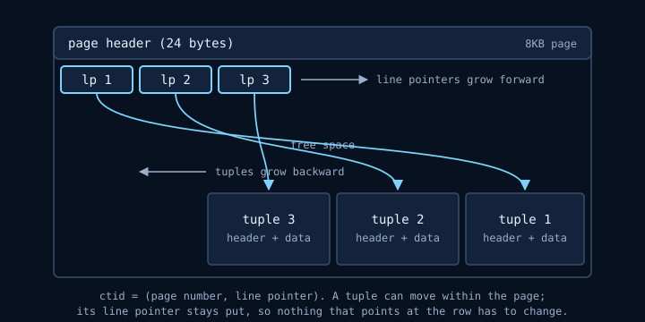
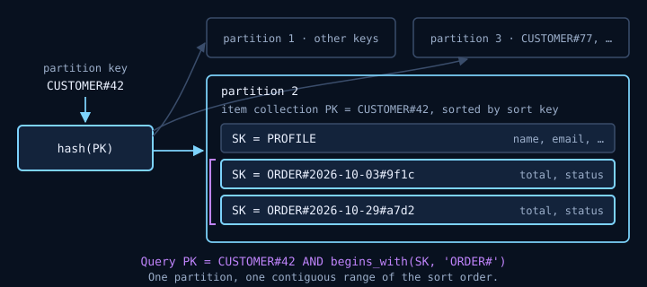

"Which database should we use?" is usually asked about products. It's better asked about the data: its shape, how it's read and written, what must survive a crash, and how big it gets. Answer those and the product mostly picks itself. Skip them and you get the database the team used last time, which works until the workload stops resembling the last one.

So this post starts with workloads, and resolves each at the end:

> **A. Orders and payments.** Customers, orders, line items, payments, refunds. Money must balance. Finance wants reports nobody has thought of yet.
>
> **B. Product telemetry.** Every click and page view, appended forever. Billions of rows a month. Queries are "daily active users by country for the last 90 days."
>
> **C. Sessions and shopping carts.** Read and written by key on every request. Tens of thousands of requests a second at peak. Single-digit millisecond budget. Expires after a few days.
>
> **D. A globally distributed user profile and catalogue.** Users in Europe, the Americas and Asia, each expecting local latency. Writes happen everywhere. Some staleness is fine; losing a user's own update in front of them is not.
>
> **E. CMS content.** Articles with wildly varying structure — some have galleries, some have embedded quizzes, some have neither. Read far more than written.

## The questions to ask first

- **Are access patterns known in advance, or ad hoc?** If you can list every query, you can design storage around them. If finance will invent new ones next quarter, you need a query planner.
- **Point lookups or scans?** Fetching one row by key and summing a column over a billion rows are opposite workloads; no single layout is optimal for both.
- **What are the relationships?** A tree (an order and its lines) can live in one document. A graph of shared entities (products in many orders) wants joins.
- **What must be atomic?** One row, one entity, one customer, or arbitrary rows? Transaction scope is one of the strongest constraints there is.
- **How consistent must reads be?** Read-your-own-writes? Globally linearizable? Is a second of staleness fine?
- **How big, how fast, growing how?**
- **Where are the users?** One region or several, and do writes happen in more than one?
- **How long does data live?** Forever, until a TTL, or until archived?
- **What's the cost model?** A server you run, a managed instance you size, or per-request billing — which changes what "an expensive query" means.

## SQL vs NoSQL, and the actual distinction

"Schema versus schemaless" is the least important difference. Every system has a schema; the question is whether the database enforces it on write or your code assumes it on read. A document store's schema lives in every piece of code that expects a field to be there, which makes it harder to change, because nobody can see all of it.

The distinction that matters is **query flexibility versus predictable scale**.

A relational database stores each fact once and reassembles data at query time with joins, using a planner that picks an execution strategy from statistics. That's what makes it good at questions nobody anticipated. Transactions span any rows, and constraints are enforced by the database itself — the only place they're reliably enforced, as the [API post]() argues. The price is that a query's cost is decided at runtime: a query that took 5ms yesterday can occasionally take 5 seconds today because the statistics changed. And scaling writes beyond one primary is hard, because transactions and constraints over arbitrary rows are hard to distribute.

"NoSQL" is a family:

- **Key-value** — get and put by key. Redis, the simplest use of DynamoDB.
- **Document** — a key maps to a JSON document you can query into. MongoDB, Cosmos DB's NoSQL API.
- **Wide-column** — rows keyed by a partition key and sorted by a clustering key. Cassandra; DynamoDB is close.
- **Graph** — nodes and edges for traversals. Neo4j, Cosmos DB's Gremlin API.

Most share the opposite trade: **you design storage around known access patterns, and in exchange every operation has a predictable cost at any scale.** Data is partitioned by a key you choose; operations within one partition are cheap regardless of total size, and operations across partitions are expensive or impossible. Transactions, where they exist, are usually scoped to a partition or capped in size.

![Two panels. Left, relational, pay at query time: customers, orders and order_lines tables, each fact stored once, feed a planner that answers any query with joins at query time; listed gains are unplanned questions and transactions across any rows, listed costs are cost decided at runtime and writes limited to one primary. Right, partitioned, pay at design time: access patterns drive a key design of PK = CUSTOMER#id and SK = ORDER#date, spreading data across partitions P1 to P3 with CUSTOMER#42 highlighted in P2, and a red dashed arc spanning P1 to P3; listed gains are one key, one partition and the same cost at any size, the listed cost is that cross-partition work is expensive or impossible](sql-vs-nosql.svg)

Neither is better; they're priced differently. A relational database charges at query time for flexibility. A partitioned store charges at design time for predictability.

### Postgres is the default for a reason

For most applications the right start is a relational database, usually Postgres — not because it wins every benchmark, but because it answers more of the questions above than anything else: ad-hoc queries, real transactions, enforced constraints, and with `jsonb` and a GIN index, a credible document store for "some fields vary per row."[^jsonb]

It stops being the default when one question has an extreme answer: write throughput or geography beyond one primary, or analytical scans over data far larger than memory. Why those break it — and why a row store is bad at scans, an LSM good at writes, a partition key so important — is underneath.

## Underneath: how a database actually stores and finds data

Storage is read and written in fixed-size pages — Postgres stores every table and index as files of 8KB pages[^filelayout] — and **a page that isn't in memory is expensive to fetch, much more so randomly than sequentially.** Postgres's planner costs a random page fetch at four times a sequential one by default, and its docs say random access to durable storage is "normally much more expensive than four times" sequential; the default is low because most random reads are assumed to hit cache.[^pagecost] Everything below — pages, indexes, logs, compaction — is about touching fewer pages, or touching them sequentially.

Postgres is the worked example: well documented, and its unusual choices make the general picture clearer.

### Pages and the heap

The page is the unit Postgres reads and writes — 16 disk sectors at a time — so reading one row means reading its whole page.[^pagelayout][^walreliability] A table page has a header, then **line pointers** growing forward, free space, and row data (**tuples**) growing backward from the end:



A row's address, its **`ctid`**, is (page, line pointer). Line pointers don't move while in use, so tuples can shift within the page without anything pointing at them changing.[^pagelayout]

The table is a **heap**: tuples in no particular order, wherever there's room. That choice matters when we get to MySQL.

Each tuple has a 23-byte header on most machines, with three fields that drive concurrency: `t_xmin` (the inserting transaction), `t_xmax` (the deleting or replacing transaction) and `t_ctid` (the newer version, if any).[^pagelayout]

Large values go to **TOAST**: past about 2KB per row, Postgres compresses large fields and, if needed, moves them to a separate table behind an 18-byte pointer, up to 1GB per value.[^toast] So wide `text` or `jsonb` columns cost little to queries that don't read them, and unchanged TOASTed values aren't rewritten when other columns update.

### MVCC: why an UPDATE is really an INSERT

With **multi-version concurrency control**, Postgres keeps multiple row versions and each transaction sees the ones committed as of its snapshot, so "reading never blocks writing and writing never blocks reading."[^mvcc] An `UPDATE` sets `t_xmax` on the old version and writes a complete new one with `t_xmin` set; snapshots choose between them by transaction ID.


The consequences:

**Dead tuples and bloat.** Old versions outlive the update, since older snapshots may need them. Once nothing can see them, **`VACUUM`** marks their space reusable — within the table, not returned to the OS.[^vacuum] Heavy updates with vacuum falling behind means bloat, in tables and indexes.

**Every index sees every version.** A new version at a new `ctid` needs a new entry in every index. One unindexed-column update on a table with eight indexes can be nine writes.

**HOT updates** avoid that. If no indexed column changes and the page has room, Postgres writes a **heap-only tuple** on the same page, chained from the old one, with no new index entries, and prunes the chain without waiting for vacuum.[^hot] That's what `fillfactor` below 100 is for, and a reason not to index columns you don't query: each one disqualifies HOT when it changes. Since PostgreSQL 16, columns covered only by BRIN indexes (below) no longer do.[^hot][^pg16]

**Transaction ID wraparound.** Transaction IDs are 32-bit and compared modularly, so every table must be vacuumed at least once per two billion transactions; vacuum **freezes** old tuples so their ID no longer matters. Fall behind and Postgres eventually stops assigning transaction IDs — a write outage — rather than let old rows appear to be in the future.[^vacuum] Hence "never disable autovacuum."

The **visibility map** ties this together: two bits per page, *all-visible* and *all-frozen*. Ordinary vacuum skips all-visible pages, wraparound vacuum skips all-frozen ones, and index-only scans use the all-visible bit to skip the heap.[^vacuum]

### The WAL: how durability works

Writing every changed page at commit would be many random writes. Instead, Postgres follows the **write-ahead log** rule: a data page may be written only *after* the log record describing the change is durable.[^wal] Commit flushes only the WAL — one sequential append, often shared by several concurrent commits — and data pages are written back lazily.[^wal] After a crash, Postgres replays the WAL from the last **checkpoint**.[^wal]

The WAL is only as durable as the hardware: drives and controllers with volatile write caches, including many SSDs, can acknowledge writes a power cut then loses.[^walreliability] And since an 8KB page spans sixteen 512-byte sectors, a crash can leave a **torn page**, so the first change to a page after each checkpoint logs the whole page image (`full_page_writes`) — which is also why WAL volume spikes after checkpoints.[^walreliability][^fullpage]

The WAL also drives replication: a streaming replica replays the primary's WAL, and **logical decoding** streams the same changes as row-level events — the clean way to feed another system without dual writes.[^logical]

The general lesson: **turn many scattered page writes into one sequential log write at commit, and write the real structure later.**[^wal] LSM trees take that to its conclusion.

### "Storage engines": Postgres's heap vs InnoDB's clustered index

Since PostgreSQL 12, a **table access method** interface lets extensions supply other storage behind the same SQL, but the built-in `heap` is the default and almost every table uses it.[^tableam] MySQL has pluggable engines chosen per table,[^mysqlengines] and its default, **InnoDB**, makes the opposite choice: a table *is* its primary key B-tree, with rows in the leaf pages — a **clustered index**. Secondary indexes store the primary key, so a lookup through one then searches the clustered index.[^innodb]

The two designs have opposite strengths:

- **Primary key range scans** are cheap in InnoDB, where rows are in key order. In Postgres a range of IDs can be scattered across pages; `CLUSTER` reorders a table once, but later writes aren't kept in order.[^cluster] (SQL Server matches InnoDB when a table has a clustered index, and uses a heap when it doesn't.[^sqlserver])
- **Secondary index lookups** are one step in Postgres (index → `ctid` → heap) and two in InnoDB (secondary → primary key → row).[^innodb]
- **Primary key size** matters more in InnoDB, where every secondary index carries a copy; MySQL recommends short keys.[^innodb]
- **Random keys** hurt InnoDB more: UUIDv4 keys insert *rows* at random positions in the table's B-tree, leaving pages 1/2 to 15/16 full against about 15/16 for sequential inserts.[^innodbphysical] In Postgres only the index takes the random insert.

### How a B-tree index works

A B-tree is a balanced tree of pages. **Leaf pages** hold keys with `ctid`s; **internal pages** hold keys with pointers to the level below; each level is a linked list, and typically over 99% of pages are leaves.[^btree]


A lookup for 145 reads one page per level down to the leaf. A range scan for 145–175 descends once, then walks right along the leaves — which is why B-trees serve `BETWEEN`, `<`, `>`, `ORDER BY` and prefix `LIKE 'foo%'`.[^indextypes] (Prefix `LIKE` needs the "C" collation or a `text_pattern_ops` index under a normal locale.[^opclass])

**Fan-out** is why this works. With 8-byte keys, an 8KB page holds a few hundred entries; call it 300. Three levels above the leaves address 300³ ≈ 27 million leaf pages, or about 8 billion rows — **four page visits for any one of 8 billion rows.** The upper levels are tiny, so they're usually cached and most lookups touch storage only at the leaf, if at all. `EXPLAIN (ANALYZE, BUFFERS)` shows it: `shared hit` for cached pages, `shared read` for fetched ones.[^explain]

The tree grows from the bottom: a full leaf **splits**, pushing a pointer into its parent, which may split in turn; a root split adds a level.[^btree] Every leaf stays the same distance from the root.

**Key order matters.** Increasing keys — identity, timestamp, UUIDv7 — always insert at the rightmost leaf, so writes touch one small region. Random keys like UUIDv4 insert everywhere, split pages everywhere and leave them partly empty (the InnoDB figures above are the same B-tree mechanism). Once the index outgrows the cache, most inserts touch an uncached leaf, which means a random page fetch. PostgreSQL 18's built-in `uuidv7()` gives unique, time-ordered keys.[^uuid][^pg18]

Two modern refinements: **deduplication** stores a repeated key once with a list of `ctid`s, shrinking low-cardinality indexes, and **bottom-up index deletion** (PostgreSQL 14) clears dead entries when update churn would otherwise split a page.[^btree]

### Using indexes well

**Composite indexes follow a leftmost-prefix rule.** An index on `(customer_id, created_at)` serves `WHERE customer_id = 42 AND created_at > '2026-01-01'` with one descent and a short walk, but serves `created_at` alone poorly, because its matches are spread across every customer. Postgres's rule: equality on leading columns plus an inequality on the next column bound the scan.[^multicolumn] So: **equality columns first, then the range column.** PostgreSQL 18's skip scan can rescue a low-cardinality unconstrained leading column, but it's a fallback, not a design.[^multicolumn][^pg18]

**Covering indexes skip the heap.** A normal index scan fetches each row from the heap in index order, the expensive way.[^explain] If the index holds every column the query needs (`INCLUDE` adds non-key columns), Postgres can do an **index-only scan** — but only for pages the visibility map marks all-visible, so on heavily updated tables it hits the heap anyway.[^indexonly]

**Partial and expression indexes** cover a subset of rows (`WHERE status = 'pending'`) or a computed value (`lower(email)`).[^partial][^expression] A partial index over the 1% of pending orders is small enough to stay cached, and the common values it leaves out wouldn't be fetched through an index anyway, so indexing them would only add size.[^partial]

**Every index costs every write** — inserts, non-HOT updates, deletes — and competes for memory.

Here's the difference in a plan, on `orders` with an index only on `id`:

```sql
EXPLAIN SELECT id, total FROM orders
WHERE customer_id = 42 AND created_at >= '2026-10-01'
ORDER BY created_at;

-- Sort
--   Sort Key: created_at
--   ->  Seq Scan on orders
--         Filter: ((customer_id = 42) AND (created_at >= '2026-10-01'))
```

The sequential scan reads every page and discards almost everything. Add a composite, covering index:

```sql
CREATE INDEX orders_customer_created
    ON orders (customer_id, created_at) INCLUDE (id, total);

-- Index Only Scan using orders_customer_created on orders
--   Index Cond: ((customer_id = 42) AND (created_at >= '2026-10-01'))
```

The scan starts at customer 42's first matching date, walks forward already in `created_at` order (so the sort disappears), and never touches the heap on all-visible pages. Drop `INCLUDE` and it becomes an index scan with a heap fetch per row. (Plans abbreviated; on a real table, read the `BUFFERS` counts.)

**The planner sometimes ignores your index, correctly.** For a large fraction of the table, sequential reading beats fetching rows out of order — the docs note a sequential scan and sort "frequently beats an index scan for sorting many rows."[^explain] The planner estimates selectivity from statistics and prices each plan with the page costs above.[^plannerstats][^pagecost] Between the extremes — too many rows for an index scan, too few for a sequential one — a **bitmap heap scan** sorts matching locations into physical order and reads each page once.[^explain] When plans go wrong, stale statistics are a likelier cause than a missing index; `ANALYZE` refreshes them.[^plannerstats]

### The other index types

B-tree is usually right. The others handle data without a single sort order:[^indextypes]

- **Hash** — equality only; rarely better than a B-tree.
- **GIN** — an inverted index, one entry per component of a value: `jsonb` containment, arrays, full-text search.
- **GiST / SP-GiST** — geometry, ranges, nearest-neighbour (`ORDER BY location <-> point`). PostGIS lives here.
- **BRIN** — a min/max summary per range of adjacent pages. Tiny, and ideal when a column tracks physical order, as timestamps do in an append-only table; lossy, so matching ranges are rechecked.[^indextypes][^brin]

### B-trees vs LSM trees

A B-tree updates **in place**: excellent reads, random-I/O writes.

A **log-structured merge tree**, introduced by O'Neil and colleagues in 1996 to make high insert rates affordable,[^lsmpaper] defers and batches instead. In RocksDB:[^rocksdb]

1. Writes go to an in-memory sorted **memtable** and a recovery log.
2. A full memtable is flushed as an immutable sorted **SST file** — a sequential write.
3. Background **compaction** merges SST files, keeping the newest version of each key.


Files are never modified in place, so writes are sequential — the cheap kind.[^rocksdb] Reads pay instead: a key may be in the memtable or several files, and **Bloom filters** let a read skip files that can't hold it. Compaction strategies trade write, read and space amplification; RocksDB's universal compaction lowers write amplification at the cost of the other two compared with leveled.[^rocksdb]

**B-trees optimise reads and pay on writes; LSM trees optimise writes and pay on reads and compaction.** Column stores are a third answer, optimised for scans.

## Row vs column storage: OLTP vs OLAP

Everything above is a **row store**: pages hold whole rows, ideal for transactional work (OLTP) that wants all columns of a few rows. It's the wrong layout for analytics (OLAP): "revenue by country for 90 days" needs two columns of a billion rows, and a row store reads every column of every one. Indexes don't help when the query needs most rows.

A **column store** stores each column's values together, so queries read only the columns they reference.[^chintro] Similar values side by side compress well, which saves storage and, since I/O is often the bottleneck, time. Vectorised execution then processes values in batches with SIMD.[^chfast]


The cost is the mirror image: reading one full row touches every column, and editing a row in compressed, sorted blocks is awkward. Column stores are for appending and reading in bulk.

### ClickHouse and MergeTree

ClickHouse's main engine family, **MergeTree**, pairs the column layout with an LSM-like write path:

```sql
CREATE TABLE events
(
    event_time  DateTime,
    event_type  LowCardinality(String),
    country     LowCardinality(String),
    user_id     UInt64,
    properties  String
)
ENGINE = MergeTree
PARTITION BY toYYYYMM(event_time)
ORDER BY (country, event_time);
```

Each insert writes an immutable, sorted **data part**, merged in the background like SST files.[^mergetree][^chfast] Hence the guidance to insert at least 1,000 rows at a time, ideally 10,000–100,000: many small inserts make parts faster than merges can absorb them.[^chinsert]

The `ORDER BY` key is a **sparse index**: one entry per **granule** (8,192 rows by default), small enough to stay in memory, used to skip granules that can't match.[^mergetree] So the sort order is the key design decision and must follow the queries. For scenario B, `(country, event_time)` keeps each country's rows contiguous and time-ordered, so a country-and-date filter skips straight to its granules; leading with `event_type` would scatter them. The rule: filtered columns, in filter order, lower-cardinality first.

Two things trip people up:

**The primary key isn't unique.**[^mergetree] `ReplacingMergeTree` deduplicates, but only when parts merge, at an unpredictable time; exact answers need `FINAL`, deduplicating at query cost.[^replacing]

**Updates and deletes are heavy.** `ALTER TABLE ... UPDATE` is an asynchronous mutation, "a heavy operation not designed for frequent use."[^alterupdate] Lightweight deletes help, but **a column store is for data you append and analyse, not edit.**

BigQuery, Snowflake and Redshift (managed, billed by scan or compute) and DuckDB (embedded) share the model; the choice between them is mostly who runs it and how you pay.

## DynamoDB: design the access patterns first

DynamoDB is AWS's managed key-value and wide-column store, and the purest example of the predictable-scale trade: single-digit-millisecond operations on tables with no practical size limit,[^dynamoquotas] provided every access pattern is designed into the keys.

**The data model.** Each item has a **partition key**, hashed to choose a partition, and optionally a **sort key**, which orders items sharing a partition key into an **item collection**. Efficient operations are `GetItem` by full key and `Query` on one partition key with a sort-key condition. Everything else is a `Scan` of the whole table.

```text
PK                 SK                         attributes
CUSTOMER#42        PROFILE                    name, email, ...
CUSTOMER#42        ORDER#2026-10-03#9f1c      total, status, ...
CUSTOMER#42        ORDER#2026-10-29#a7d2      total, status, ...
CUSTOMER#77        PROFILE                    ...
```



"A customer and their orders, newest first" is one `Query`: `PK = CUSTOMER#42 AND begins_with(SK, 'ORDER#')`, reversed. This is **single-table design** — entity types sharing a table, with key prefixes chosen so each access pattern is one query. It's efficient, but the table is unreadable without the access-pattern list behind it, and a pattern the keys didn't anticipate can mean a migration.

**Secondary indexes** add access patterns. A **global secondary index** has its own keys and is updated asynchronously, so its reads are eventually consistent.[^dynamoconsistency] A **local secondary index** shares the partition key with a different sort key, must be created with the table, and caps each item collection at 10GB.[^dynamolimits] Defaults: 20 GSIs, 5 LSIs.[^dynamoquotas]

**Limits that shape design:**

- Items are at most **400KB**, attribute names included; blobs go in S3.[^dynamolimits]
- `Query` and `Scan` return at most **1MB per call**, paginated.[^dynamolimits]
- Transactions cover at most **100 items and 4MB** in one region; global tables can expose a partly replicated transaction elsewhere.[^dynamolimits]
- Each partition delivers up to **3,000 read and 1,000 write units per second**.[^dynamopartition]

**Hot partitions** follow from that last limit: one key with outsized traffic — a celebrity, a popular product, today's date — throttles while the table idles. **Adaptive capacity** shifts throughput and can isolate a hot item, but can't lift one key past the partition maximum.[^dynamoadaptive] Beyond that, **write sharding** spreads a key across suffixes, at the cost of querying and merging every suffix to read it back.[^dynamosharding]

**Consistency.** In-region reads are eventually consistent by default; strong reads work on tables and LSIs, not GSIs, at twice the cost, and transactional operations cost double.[^dynamoconsistency][^dynamolimits] **Global tables** replicate to several writable regions with eventual consistency (typically within a second) or multi-Region strong consistency, where writes replicate synchronously before returning.[^dynamoconsistency]

**Capacity.** On-demand is pay-per-request and AWS's recommended default; provisioned suits steady, forecastable load.[^dynamocapacity]

**TTL and Streams.** Expired items are deleted free, but only "within a few days," so reads must filter them.[^dynamottl] **Streams** record item changes for 24 hours, feeding other systems without dual writes.[^dynamostreams]

DynamoDB fails in a specific way: it runs beautifully until someone needs a query the keys don't support — "all orders over £500 last month." Then it's a full scan, a new GSI, or an export. **DynamoDB is excellent when the questions are fixed and the wrong home for questions that aren't.**

## Azure Cosmos DB: partitioning, RUs, and five consistency levels

Cosmos DB is Azure's globally distributed database, at its core a partitioned document store. It overlaps heavily with DynamoDB — key-partitioned data, cheap single-partition operations, expensive cross-partition work — and differs in cost model, indexing and consistency.

**Request Units.** Every operation costs RUs, a normalised currency for CPU, I/O and memory: about 1 RU for a 1KB point read, more for writes and queries, and always the same for the same operation.[^ru] Throughput is provisioned (in 100 RU/s steps, or autoscale, in every replicated region) or serverless.[^ru] Each response reports its RU charge, so you can measure every access pattern while designing.

**Partitioning.** Items sharing a partition key value form a **logical partition** of up to 20GB, mapped onto **physical partitions** of up to 10,000 RU/s and 50GB — so one key value is capped at 10,000 RU/s, the same hot-key problem as DynamoDB.[^partitioning] Partition keys can't be changed in place; **hierarchical keys** (up to three levels) ease the 20GB limit.[^partitioning] The logical partition is also the **transaction boundary**, and a query without the partition key fans out to every physical partition at an extra 2–3 RU each.[^partitioning]

**Indexing.** Unlike DynamoDB, Cosmos indexes **every property by default**, so ad-hoc filters just work. Writes pay for it, and excluding never-queried paths is one of the best cost optimisations.[^indexpolicy] **Composite indexes** are required for multi-property `ORDER BY` (same paths in the same order, with all directions matching or all reversed) and help filters when ordered equality-first, range-last.[^indexpolicy]

**Consistency.** Five levels, strongest first:[^consistency]

- **Strong** — linearizable. Writes commit in every region, so write latency is about twice the round trip between the two farthest regions; unavailable with multiple write regions.
- **Bounded staleness** — reads lag by at most *K* versions or *T* time.
- **Session** — read-your-writes within a client session. The most used level.
- **Consistent prefix** — possibly stale, never out of order.
- **Eventual** — no ordering guarantee.

Strong and bounded staleness read two replicas, so reads cost about double.[^consistency] **Session is usually right for user-facing apps**: users see their own changes immediately, at single-replica prices.

**Multi-region writes.** Concurrent writes to one item in different regions conflict, and by default **last writer wins** on the timestamp, with deletes winning; the NoSQL API supports custom merge procedures.[^conflicts] Some concurrent writes are silently discarded, so this suits data where that's acceptable or each item is written from one region at a time.

**Change feed.** Inserts and updates, ordered per partition key; "all versions and deletes" mode captures deletes but needs continuous backup.[^changefeed] It's the counterpart of DynamoDB Streams and logical decoding.

Cosmos also offers MongoDB, Cassandra, Gremlin and Table APIs alongside its native one, but the partitioning, RU and consistency model apply underneath whichever you use.[^ru]

**Cosmos vs DynamoDB.** They're more alike than different. Cosmos tolerates ad-hoc queries better, through default indexing and a SQL-like language, and has finer consistency control. DynamoDB pushes harder toward designing every access pattern into keys and has a simpler cost model. Usually the cloud you're on decides.

## Trade-offs side by side

| | Postgres | SQL Server / MySQL InnoDB | MongoDB[^wiredtiger][^mongotx] | ClickHouse | DynamoDB | Cosmos DB |
|---|---|---|---|---|---|---|
| **Storage structure** | Row pages in an unordered heap; B-tree indexes | Row pages in a clustered B-tree (or a heap, in SQL Server, without one) | Documents in the WiredTiger engine | Immutable columnar parts, merged in background | Partitioned item collections, sorted by sort key | Partitioned documents |
| **Indexing** | You choose; many index types | You choose | You choose | Sparse primary index on the sort key | Primary key plus GSIs/LSIs you design | Every property by default; tune by exclusion |
| **Query flexibility** | Highest; joins and a planner | Highest; joins and a planner | High within a document | High for aggregates; poor for point lookups | Designed access patterns only | SQL-like over documents; cross-partition costs RUs |
| **Transactions** | Arbitrary, ACID | Arbitrary, ACID | Single-document atomic; multi-document at extra cost | None in the OLTP sense | Up to 100 items / 4MB | Within one logical partition |
| **Consistency** | Strong on the primary | Strong on the primary | Tunable | Duplicates resolved only at merge, or with `FINAL` | Eventual or strong; global tables eventual or strong | Five levels |
| **Cost model** | Instance size | Instance size | Instance or managed tier | Instance or compute | Per request or provisioned | RU/s or serverless |
| **Characteristic failure** *(opinion)* | Bad plan or bloat under load; write ceiling | Random-key page splits; wide primary keys | Unbounded documents; schema drift | Treating it as OLTP | A query the keys don't support | Hot or oversized partition; RU bill |

## Polyglot persistence, and when not to

Real systems often pair a transactional source of truth with an analytical store fed from its log: Postgres to ClickHouse via logical decoding, DynamoDB via Streams, Cosmos via the change feed.[^logical][^dynamostreams][^changefeed] Never write to both from application code and hope both succeed; write to one and propagate from its log, as the [API post]() describes.

But every store is another system to run, secure, back up and understand, and another consistency boundary. The usual mistake isn't too few databases; it's adding a second before the first has run out. Postgres with `jsonb`, partial indexes and a read replica covers far more than it gets credit for.

**Use one database until a specific workload forces a second, and be able to name the workload.**

## Where this leaves the scenarios

**A. Orders and payments → Postgres.** The deciding questions are *what must be atomic* (order, lines and payment together) and *are queries known* (no — finance will invent them). That's the relational sweet spot: multi-row transactions, database-enforced constraints (including the unique constraint behind idempotency), and a planner for ad-hoc reports. Use identity or UUIDv7 keys, composite indexes like `(customer_id, created_at)` for hot paths, and keep analytics off the primary — a replica first, an analytical store later. Given up: horizontal write scaling, which this workload rarely needs.

**B. Product telemetry → ClickHouse (or a managed warehouse).** It's all scans and aggregates over append-only data, where columnar storage and compression are the only cheap option. `ORDER BY (country, event_time)` to match the query, a second sorted table or projection if another pattern becomes as important, monthly partitions so old data drops cheaply, and inserts batched in the tens of thousands. Given up: updates, uniqueness and point lookups. If it must stay in Postgres for now, BRIN on the timestamp plus monthly partitions go a long way.

**C. Sessions and carts → DynamoDB (or Cosmos DB on Azure).** Known access pattern (by session ID), tight latency, TTL. Partition key `SESSION#<id>`, a TTL attribute, on-demand capacity. Random high-cardinality IDs mean no hot partitions. Check expiry on read, since TTL deletion lags. (Redis works too if losing a session is acceptable; losing a cart usually isn't.)

**D. Global profile and catalogue → Cosmos DB, multi-region writes, session consistency.** Local latency everywhere and users seeing their own updates is session consistency almost word for word. Partition profiles by user ID and the catalogue by product ID; category ID would be a low-cardinality key, giving a hot partition and a 20GB ceiling with no way to change it in place. Serve category browsing with a Cosmos global secondary index — a copy of the container partitioned by category, kept eventually consistent with the source.[^partitioning] Exclude unqueried index paths. Given up: global strong consistency, with concurrent cross-region edits resolved by last writer wins — so make profile edits per-field, not whole-document replaces. (On AWS, global tables in eventual mode are the equivalent; strong mode gives up the local write latency this scenario needs.)

**E. CMS content → Postgres with `jsonb`.** The content looks like documents, but authors, tags, state and slugs are relational, reads are modest and cacheable, and editors will filter in unplanned ways. Keep common fields as columns, the variable body as `jsonb`, and add a GIN index if you query into it. "The data looks like documents" isn't on its own a reason to choose a document database.

The method, once more: **describe the data and its requirements first, then let them choose the store** — and know which trade you made, because each of these systems is fast at something precisely because it's slow at something else.

[^jsonb]: PostgreSQL, ["JSON Types"](https://www.postgresql.org/docs/current/datatype-json.html) and ["Index Types"](https://www.postgresql.org/docs/current/indexes-types.html) — `jsonb` storage and GIN indexing of `jsonb` containment.
[^pagelayout]: PostgreSQL, ["Database Page Layout"](https://www.postgresql.org/docs/current/storage-page-layout.html) — 8KB default pages, the page header, line pointers, the 23-byte tuple header and `t_xmin`/`t_xmax`/`t_ctid`.
[^toast]: PostgreSQL, ["TOAST"](https://www.postgresql.org/docs/current/storage-toast.html) — the ~2KB threshold, the 18-byte pointer, the 1GB value limit and storage strategies.
[^mvcc]: PostgreSQL, ["Concurrency Control: Introduction"](https://www.postgresql.org/docs/current/mvcc-intro.html) — "reading never blocks writing and writing never blocks reading."
[^vacuum]: PostgreSQL, ["Routine Vacuuming"](https://www.postgresql.org/docs/current/routine-vacuuming.html) — dead row versions, the visibility map, 32-bit transaction IDs, freezing, and wraparound protection.
[^hot]: PostgreSQL, ["Heap-Only Tuples (HOT)"](https://www.postgresql.org/docs/current/storage-hot.html) — the two conditions for a HOT update, its benefits, and `fillfactor`.
[^wal]: PostgreSQL, ["Write-Ahead Logging (WAL)"](https://www.postgresql.org/docs/current/wal-intro.html) — log-before-data, REDO recovery, and why WAL reduces disk writes.
[^logical]: PostgreSQL, ["Logical Decoding"](https://www.postgresql.org/docs/current/logicaldecoding.html) — streaming row-level changes out of the WAL.
[^tableam]: PostgreSQL, ["Table Access Method Interface Definition"](https://www.postgresql.org/docs/current/tableam.html), the [`default_table_access_method`](https://www.postgresql.org/docs/current/runtime-config-client.html) setting (default `heap`), and the [PostgreSQL 12 release notes](https://www.postgresql.org/docs/release/12.0/), which introduced pluggable table storage.
[^innodb]: MySQL, ["Clustered and Secondary Indexes"](https://dev.mysql.com/doc/refman/8.4/en/innodb-index-types.html) — InnoDB rows stored in the primary key index, and secondary indexes carrying the primary key.
[^btree]: PostgreSQL, ["B-Tree Indexes: Implementation"](https://www.postgresql.org/docs/current/btree.html) — leaf and internal pages, page splits and root splits, deduplication, and bottom-up index deletion (new in PostgreSQL 14).
[^indextypes]: PostgreSQL, ["Index Types"](https://www.postgresql.org/docs/current/indexes-types.html) — B-tree, Hash, GiST, SP-GiST, GIN and BRIN, and the operators each supports.
[^uuid]: PostgreSQL, ["UUID Functions"](https://www.postgresql.org/docs/current/functions-uuid.html) — `uuidv7()` (time-ordered) and `gen_random_uuid()`/`uuidv4()` (random).
[^multicolumn]: PostgreSQL, ["Multicolumn Indexes"](https://www.postgresql.org/docs/current/indexes-multicolumn.html) — the leading-column rule and skip scan.
[^indexonly]: PostgreSQL, ["Index-Only Scans and Covering Indexes"](https://www.postgresql.org/docs/current/indexes-index-only-scans.html) — requirements, the visibility map dependency, and `INCLUDE`.
[^rocksdb]: RocksDB wiki, ["RocksDB Overview"](https://github.com/facebook/rocksdb/wiki/RocksDB-Overview) — memtable, log, SST files, compaction styles, Bloom filters and amplification trade-offs.
[^mergetree]: ClickHouse, ["MergeTree"](https://clickhouse.com/docs/engines/table-engines/mergetree-family/mergetree) — data parts and background merges, the sparse primary index, 8,192-row granules, and non-unique primary keys.
[^replacing]: ClickHouse, ["ReplacingMergeTree"](https://clickhouse.com/docs/engines/table-engines/mergetree-family/replacingmergetree) — deduplication only during merges, no guarantee of no duplicates, and `FINAL`.
[^alterupdate]: ClickHouse, ["ALTER TABLE … UPDATE"](https://clickhouse.com/docs/sql-reference/statements/alter/update) and ["Updating and Deleting ClickHouse Data"](https://clickhouse.com/docs/guides/developer/mutations) — mutations as heavy, asynchronous operations, and lightweight deletes.
[^dynamoquotas]: AWS, ["Quotas in Amazon DynamoDB"](https://docs.aws.amazon.com/amazondynamodb/latest/developerguide/ServiceQuotas.html) — no practical table size limit; 5 LSIs and a default of 20 GSIs per table.
[^dynamolimits]: AWS, ["Constraints in Amazon DynamoDB"](https://docs.aws.amazon.com/amazondynamodb/latest/developerguide/Constraints.html) — the 400KB item limit, the 10GB item collection limit with LSIs, transaction limits, transactional capacity cost, and the 1MB Query/Scan page.
[^dynamopartition]: AWS, ["Best practices for designing and using partition keys effectively"](https://docs.aws.amazon.com/amazondynamodb/latest/developerguide/bp-partition-key-design.html) — 3,000 read units and 1,000 write units per second per partition.
[^dynamoadaptive]: AWS, ["DynamoDB burst and adaptive capacity"](https://docs.aws.amazon.com/amazondynamodb/latest/developerguide/burst-adaptive-capacity.html) — adaptive capacity and isolating frequently accessed items.
[^dynamoconsistency]: AWS, ["DynamoDB read consistency"](https://docs.aws.amazon.com/amazondynamodb/latest/developerguide/HowItWorks.ReadConsistency.html) — eventual by default, strong reads on tables and LSIs only, at twice the cost.
[^dynamottl]: AWS, ["Using time to live (TTL) in DynamoDB"](https://docs.aws.amazon.com/amazondynamodb/latest/developerguide/howitworks-ttl.html) — deletion typically within a few days of expiry, without consuming write throughput.
[^ru]: Microsoft, ["Request Units in Azure Cosmos DB"](https://learn.microsoft.com/en-us/azure/cosmos-db/request-units) — the 1 RU point read, throughput modes, per-region provisioning, and the supported APIs.
[^partitioning]: Microsoft, ["Partitioning and horizontal scaling in Azure Cosmos DB"](https://learn.microsoft.com/en-us/azure/cosmos-db/partitioning-overview) — 20GB logical partitions, 10,000 RU/s and 50GB physical partitions, immutable partition keys, hierarchical keys, transaction scope, the cross-partition query cost, and global secondary indexes as eventually consistent copies partitioned differently.
[^indexpolicy]: Microsoft, ["Indexing policies in Azure Cosmos DB"](https://learn.microsoft.com/en-us/azure/cosmos-db/index-policy) — index-everything by default, excluding paths to reduce write RUs, and composite index rules.
[^consistency]: Microsoft, ["Consistency levels in Azure Cosmos DB"](https://learn.microsoft.com/en-us/azure/cosmos-db/consistency-levels) — the five levels, strong-consistency write latency, no strong consistency with multiple write regions, and the doubled read cost of strong and bounded staleness.
[^conflicts]: Microsoft, ["Conflict resolution types and resolution policies"](https://learn.microsoft.com/en-us/azure/cosmos-db/conflict-resolution-policies) — last-writer-wins on `_ts` by default, deletes winning, and custom merge procedures.
[^changefeed]: Microsoft, ["Change feed in Azure Cosmos DB"](https://learn.microsoft.com/en-us/azure/cosmos-db/change-feed) — per-partition-key ordering, latest-version vs all-versions-and-deletes modes.
[^filelayout]: PostgreSQL, ["Database File Layout"](https://www.postgresql.org/docs/current/storage-file-layout.html) — each table and index stored as its own file, split into 1GB segments, whose contents are the pages described in "Database Page Layout."
[^pagecost]: PostgreSQL, ["Query Planning: Planner Cost Constants"](https://www.postgresql.org/docs/current/runtime-config-query.html#RUNTIME-CONFIG-QUERY-CONSTANTS) — `seq_page_cost` (default 1.0), `random_page_cost` (default 4.0), and the note that random access to durable storage is normally much more than four times as expensive, with the default assuming most random reads are cached.
[^walreliability]: PostgreSQL, ["Reliability"](https://www.postgresql.org/docs/current/wal-reliability.html) — `fsync`, volatile write-back caches on drives, controllers and many SSDs, 512-byte sectors and 8KB page writes, and partial-page writes during power loss.
[^fullpage]: PostgreSQL, ["Write Ahead Log: Settings — `full_page_writes`"](https://www.postgresql.org/docs/current/runtime-config-wal.html#GUC-FULL-PAGE-WRITES) — full page images on the first modification after a checkpoint, why torn pages need them, and the link to checkpoint spacing.
[^pg16]: PostgreSQL, ["Release 16"](https://www.postgresql.org/docs/release/16.0/) — "Allow HOT updates if only BRIN-indexed columns are updated."
[^pg18]: PostgreSQL, ["Release 18"](https://www.postgresql.org/docs/release/18.0/) — B-tree skip scan, and the new `uuidv7()` function for time-ordered UUIDs.
[^mysqlengines]: MySQL, ["Alternative Storage Engines"](https://dev.mysql.com/doc/refman/8.4/en/storage-engines.html) — the pluggable storage engine architecture, per-table engine choice, and InnoDB as the default.
[^innodbphysical]: MySQL, ["The Physical Structure of an InnoDB Index"](https://dev.mysql.com/doc/refman/8.4/en/innodb-physical-structure.html) — pages about 15/16 full under sequential inserts and from 1/2 to 15/16 full under random inserts.
[^cluster]: PostgreSQL, ["CLUSTER"](https://www.postgresql.org/docs/current/sql-cluster.html) — physically reordering a table by an index, why it helps range scans, and why it's a one-time operation.
[^sqlserver]: Microsoft, ["Clustered and nonclustered indexes"](https://learn.microsoft.com/en-us/sql/relational-databases/indexes/clustered-and-nonclustered-indexes-described) — rows stored in clustered-key order, or in an unordered heap when a table has no clustered index.
[^opclass]: PostgreSQL, ["Operator Classes and Operator Families"](https://www.postgresql.org/docs/current/indexes-opclass.html) — `text_pattern_ops` and `varchar_pattern_ops` for `LIKE` when the database doesn't use the C locale.
[^explain]: PostgreSQL, ["Using EXPLAIN"](https://www.postgresql.org/docs/current/using-explain.html) — bitmap heap scans sorting row locations into physical order, index scans fetching rows in index order, sequential scan and sort versus index scans, and the `BUFFERS` option.
[^plannerstats]: PostgreSQL, ["Statistics Used by the Planner"](https://www.postgresql.org/docs/current/planner-stats.html) — selectivity estimates, statistics gathered by `ANALYZE`, and why they go out of date.
[^partial]: PostgreSQL, ["Partial Indexes"](https://www.postgresql.org/docs/current/indexes-partial.html) — indexing a subset of rows, and avoiding indexing common values that queries wouldn't use the index for anyway.
[^expression]: PostgreSQL, ["Indexes on Expressions"](https://www.postgresql.org/docs/current/indexes-expressional.html) — indexing a computed value such as `lower(col)`.
[^brin]: PostgreSQL, ["BRIN Indexes: Introduction"](https://www.postgresql.org/docs/current/brin.html) — block range summaries, the correlation with physical location they depend on, their small size, `pages_per_range`, and lossy rechecks.
[^lsmpaper]: Patrick O'Neil, Edward Cheng, Dieter Gawlick and Elizabeth O'Neil, ["The Log-Structured Merge-Tree (LSM-Tree)"](https://doi.org/10.1007/s002360050048), *Acta Informatica* 33(4), 1996 — the original design.
[^chintro]: ClickHouse, ["What is ClickHouse?"](https://clickhouse.com/docs/intro) — column values stored sequentially, and only the columns a query needs read from disk.
[^chfast]: ClickHouse, ["Why is ClickHouse so fast?"](https://clickhouse.com/docs/concepts/why-clickhouse-is-so-fast) — a part per insert with background merges, why column stores suit compression, and vectorised execution with SIMD.
[^chinsert]: ClickHouse, ["Selecting an insert strategy"](https://clickhouse.com/docs/best-practices/selecting-an-insert-strategy) — batches of at least 1,000 rows, ideally 10,000–100,000, and the cost of many small parts.
[^dynamosharding]: AWS, ["Using write sharding to distribute workloads evenly"](https://docs.aws.amazon.com/amazondynamodb/latest/developerguide/bp-partition-key-sharding.html) — random and calculated suffixes, and querying every suffix to read the data back.
[^dynamocapacity]: AWS, ["DynamoDB throughput capacity"](https://docs.aws.amazon.com/amazondynamodb/latest/developerguide/capacity-mode.html) — on-demand as the default and recommended mode, and when provisioned fits.
[^dynamostreams]: AWS, ["Change data capture for DynamoDB Streams"](https://docs.aws.amazon.com/amazondynamodb/latest/developerguide/Streams.html) — a time-ordered sequence of item-level changes, kept for 24 hours.
[^wiredtiger]: MongoDB, ["WiredTiger Storage Engine"](https://www.mongodb.com/docs/manual/core/wiredtiger/) — the default engine, document-level concurrency, compression, checkpoints and the journal.
[^mongotx]: MongoDB, ["Transactions"](https://www.mongodb.com/docs/manual/core/transactions/) — single-document atomicity, multi-document distributed transactions, and their greater performance cost.
